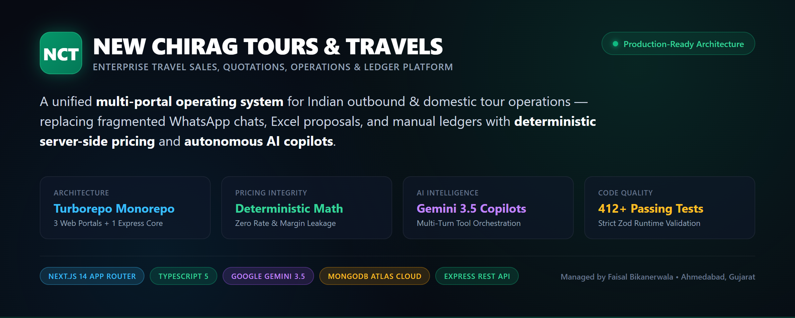
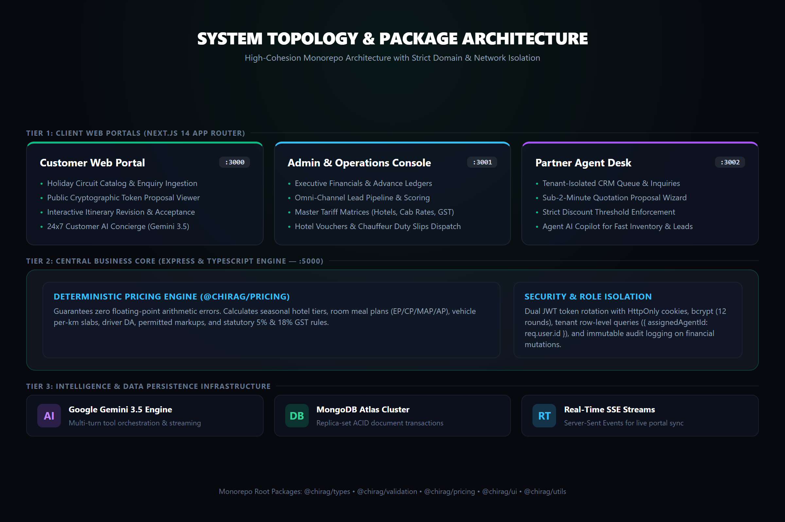
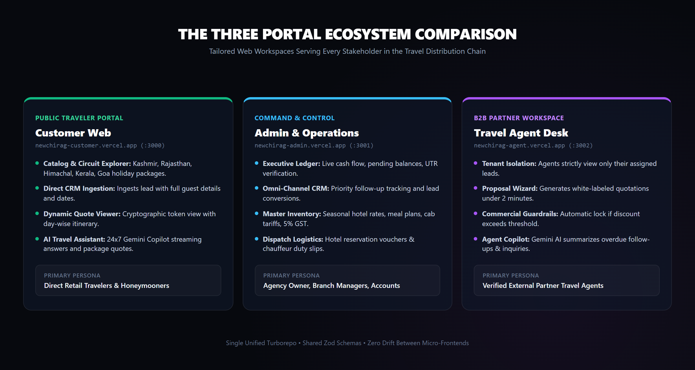
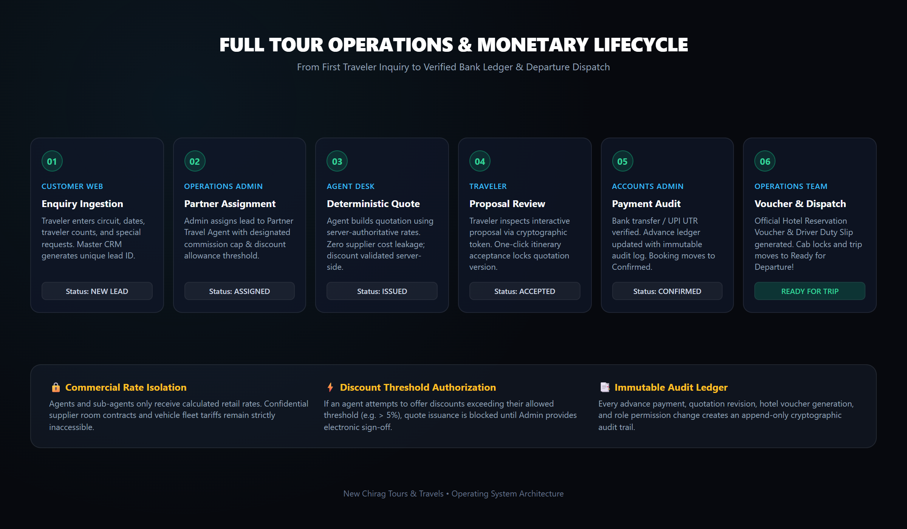
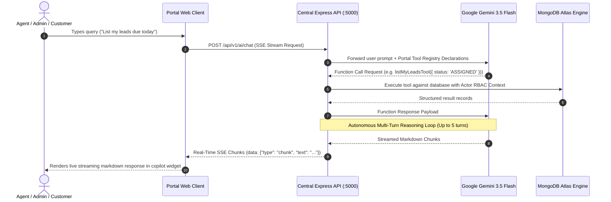

<div align="center">



# NEW CHIRAG TOURS & TRAVELS
### Enterprise Multi-Portal Tour Operations, Quotation Lifecycle & Financial Ledger Platform

[](https://turbo.build/)
[](https://nextjs.org/)
[](https://www.typescriptlang.org/)
[](https://expressjs.com/)
[](https://deepmind.google/technologies/gemini/)
[](https://www.mongodb.com/atlas)
[](https://jestjs.io/)

<br/>

**Live Production Deployments:**

| Web Application | Production Endpoint | Primary Persona | Status |
| :--- | :--- | :--- | :---: |
| 🌐 **Customer Web Portal** | [`newchirag-customer.vercel.app`](https://newchirag-customer.vercel.app) | Retail Travelers, Honeymooners, Families |  |
| 🛡️ **Operations & Admin Console** | [`newchirag-admin.vercel.app`](https://newchirag-admin.vercel.app) | Owner, Branch Managers, Accounts, Dispatchers |  |
| 💼 **B2B Partner Agent Desk** | [`newchirag-agent.vercel.app`](https://newchirag-agent.vercel.app) | Verified External Travel Agents & Sub-Desks |  |
| ⚡ **Central REST API Engine** | [`newchirag-api.onrender.com`](https://newchirag-api.onrender.com/health) | Authoritative Pricing, CRM, Ledgers & AI Orchestration |  |

---

</div>

## 📑 Table of Contents
1. [Executive Overview & Vision](#1-executive-overview--vision)
2. [System Architecture & Monorepo Topology](#2-system-architecture--monorepo-topology)
3. [The Three Portals Ecosystem](#3-the-three-portals-ecosystem)
4. [Tour Operations & Financial Ledger Lifecycle](#4-tour-operations--financial-ledger-lifecycle)
5. [Deterministic Tour Pricing & GST Math Engine](#5-deterministic-tour-pricing--gst-math-engine)
6. [Autonomous Google Gemini 3.5 AI Copilots](#6-autonomous-google-gemini-35-ai-copilots)
7. [Security, RBAC & Commercial Guardrails](#7-security-rbac--commercial-guardrails)
8. [Automated Verification & Test Census](#8-automated-verification--test-census)
9. [Installation, Setup & Deployment Guide](#9-installation-setup--deployment-guide)
10. [Governance & Production Access](#10-governance--production-access)

---

## 1. Executive Overview & Vision

**New Chirag Tours & Travels** is a purpose-built, full-lifecycle digital operating system designed specifically for Indian domestic circuits (Kashmir, Himachal, Rajasthan, Kerala, Goa, Andaman) and outbound operations.

### Traditional Agency Pain Points vs Our Platform Solution:
* ❌ **Scattered WhatsApp Chats:** Lead requirements get lost across personal phones.  
  ➡️ **Our Solution:** Unified omni-channel CRM with priority queues (`Due Today`, `Overdue Follow-ups`, `Unassigned`).
* ❌ **Excel Spreadsheet Errors:** Quotations suffer from broken formulas, outdated seasonal tariffs, and rounding glitches.  
  ➡️ **Our Solution:** Pure deterministic `@chirag/pricing` engine calculating exact integer-rounded INR rates.
* ❌ **Margin & Supplier Leakage:** Customers or external sub-agents accidentally see hotel net rates or supplier costs.  
  ➡️ **Our Solution:** Cryptographic token isolation. Agents and travelers only receive authoritative retail prices.
* ❌ **Missing Duty Slips & Disconnected Drivers:** Cab drivers arrive late without confirmed hotel reservation vouchers.  
  ➡️ **Our Solution:** Operations Dispatch module issuing immutable Hotel Vouchers and Chauffeur Duty Slips with cab schedule locks.
* ❌ **Dispute-Prone Payments:** Unverified bank transfers and cash collections lead to accounting disputes.  
  ➡️ **Our Solution:** Strict financial booking ledger tracking contracted amounts, verified bank UTRs, and immutable audit logs.

---

## 2. System Architecture & Monorepo Topology

<div align="center">



</div>

The platform is engineered as a high-cohesion, low-coupling **Turborepo** workspace with strict package boundaries:

```
newchirag/
├── apps/
│   ├── api/             # Central Express 4.x + TypeScript Authoritative Engine (Port 5000)
│   ├── admin-web/       # Next.js 14 App Router Admin & Operations Console (Port 3001)
│   ├── agent-web/       # Next.js 14 App Router B2B Partner Travel Desk (Port 3002)
│   └── customer-web/    # Next.js 14 App Router Public Customer Web Portal (Port 3000)
│
├── packages/
│   ├── types/           # Authoritative TypeScript interfaces, DTOs & contracts (@chirag/types)
│   ├── validation/      # Shared runtime Zod schemas validating every API contract (@chirag/validation)
│   ├── pricing/         # Deterministic integer-rounded pricing calculation engine (@chirag/pricing)
│   ├── ui/              # Reusable React components & emerald design tokens (@chirag/ui)
│   ├── utils/           # Date math, currency formatters, and slug utilities (@chirag/utils)
│   └── config/          # Centralized ESLint, Prettier, and TypeScript configurations (@chirag/config)
│
└── docs/                # Architectural blueprints, PRDs, audits, and visual schematics
```

### Technology Highlights
* **Frontend Micro-Frontends:** Next.js 14 (App Router), React 18, Vanilla CSS Design System with curated emerald tokens (`#0f766e`, `#059669`, `#0f172a`, `#f0fdfa`). Prefetching and mount-only state setters guarantee silky-smooth 60fps interaction.
* **Backend Core Engine:** Node.js (v20+ LTS), Express.js, TypeScript 5, Mongoose ODM, MongoDB Atlas Cloud with replica set transactions.
* **Artificial Intelligence:** Google Gemini 3.5 Flash with autonomous multi-turn tool calling and Server-Sent Events (SSE) streaming.
* **Security & Crypto:** bcryptjs (12 salt rounds), dual JWT rotation (short-lived access + HttpOnly refresh cookies), Helmet security headers, Express rate limiting, and CORS origin guards.

---

## 3. The Three Portals Ecosystem

<div align="center">



</div>

The platform provides three independent web applications serving distinct personas in the travel distribution hierarchy:

### 1. Customer Web Portal (`:3000` / `newchirag-customer.vercel.app`)
*Target Audience: Retail travelers, honeymooners, families, and corporate tour planners.*
* **Holiday Package Discovery:** Browse and filter curated domestic packages (Kashmir Paradise, Himachal Circuit, Royal Rajasthan, Kerala Backwaters, Goa Beach Escape, Andaman Islands).
* **Live Custom Enquiry Ingestion:** Travelers submit personalized trip requests (destinations, dates, adult/child counts, hotel category preferences, special requirements) directly into the master CRM.
* **Public Quotation Proposal Viewer (`/quote/[token]`):** Interactive quotation link shared with the traveler. Travelers can view day-wise itineraries, included hotels, meal plans, vehicle details, pricing breakdowns, and click **Accept Quotation** or **Request Itinerary Changes**.
* **24x7 AI Travel Assistant:** Interactive Google Gemini copilot answering traveler questions, recommending circuits, and generating instant estimates.

### 2. Admin & Operations Console (`:3001` / `newchirag-admin.vercel.app`)
*Target Audience: Agency Owner (Faisal Bikanerwala), Operations Dispatchers, Sales Managers, Accounts Team.*
* **Executive Financial Dashboard (`/`):** Contracted booking values, received advances, pending balances, lead conversion funnels, regional destination popularity, and dynamic date filtering (`7d`, `30d`, `90d`, `This Month`, `All Time`).
* **Omni-Channel Lead Pipeline (`/leads`):** Multi-view CRM supporting **List View**, **Pipeline Board (Kanban)**, and **Conversion Funnel Metrics**. Includes priority queues (`Overdue Follow-ups`, `Due Today`, `New Ingestion`, `Action Needed`).
* **Client & Traveler Directory (`/customers`):** Master traveler registry with auto-deduplication, mobile normalization, booking histories, and source attribution (`CUSTOMER_WEB`, `ADMIN_DIRECT`, `AGENT`).
* **Master Inventory & Governance:**
  * **Destinations (`/destinations`):** Geographic regions, cities, and attractions.
  * **Hotels & Room Categories (`/hotels`):** Supplier hotels, standard/deluxe/suite rooms, contact desks.
  * **Hotel Rates & Seasons (`/seasons`):** Peak, regular, and off-season tariff matrices with meal plans (EP, CP, MAP, AP).
  * **Cabs & Fleet (`/transport`):** Vehicle categories (Sedan, Ertiga, Innova, Crysta, Tempo Traveller), per-km rates, and driver DA rules.
  * **GST & Tax Configuration (`/taxes`):** Official 5% tour package and 18% transport GST rules with approval status locks.
* **Tour Operations & Dispatch Console (`/operations`):** Operational logistics hub monitoring hotel reservation voucher status, immutable voucher issuance, chauffeur duty slips, cab schedule locks, and dispatch readiness scores.
* **Audit Trail (`/audit-logs`):** Immutable chronological log of every administrative action, price change, login event, and payment verification.

### 3. B2B Partner Travel Agent Desk (`:3002` / `newchirag-agent.vercel.app`)
*Target Audience: Verified external partner travel agents and regional booking desks across India.*
* **Tenant-Isolated Workspace:** Dedicated greeting with registered agency name, assigned commission tier (e.g., 10%), and discount allowance caps (e.g., 6%). Agents strictly view only their assigned leads.
* **Fast Quotation Proposal Wizard (`/quotations/new`):** Select from master packages, customize accommodations and cabs, apply permitted markups or discounts, and generate client-ready proposals in under 2 minutes.
* **Commercial Guardrails:** If an agent attempts to offer a discount higher than their permitted threshold (e.g. > 6%), the system automatically blocks issuance and flags the quotation as `REQUIRES_ADMIN_APPROVAL`.
* **Agent AI Copilot:** Specialized AI assistant retrieving assigned inquiries, listing overdue follow-ups, and providing instant CRM telemetry.

---

## 4. Tour Operations & Financial Ledger Lifecycle

<div align="center">



</div>

### Chronological 6-Step Workflow:
1. **Traveler Enquiry Ingestion:** A customer submits holiday preferences on the Customer Portal (or walk-in lead logged by staff). A normalized lead record (`NCT-LD-xxxx`) is created with priority scoring.
2. **Lead Assignment & Commercial Caps:** Admin assigns the lead to a verified Partner Agent with defined commission tiers and discount caps.
3. **Deterministic Quotation Generation:** The agent configures hotels, room meal plans, and vehicle options. The `@chirag/pricing` engine calculates authoritative totals without exposing supplier costs.
4. **Interactive Proposal Sharing & Acceptance:** Traveler reviews the live proposal via an immutable cryptographic token (`/quote/:token`). One-click acceptance locks the quotation version and creates an unconfirmed booking.
5. **Payment Audit & Ledger Lock:** Traveler submits payment reference (Bank UTR / Cash voucher). Accounts Admin verifies the transaction in the ledger, moving the booking status to `CONFIRMED`.
6. **Dispatch Operations:** The Operations team generates the official **Hotel Reservation Voucher** and **Chauffeur Duty Slip**, locking vehicle schedules. The booking is marked `100% READY_FOR_TRIP`.

---

## 5. Deterministic Tour Pricing & GST Math Engine

The platform eliminates floating-point rounding errors by using the pure TypeScript `@chirag/pricing` engine with integer-rounded Indian Rupee ($\text{INR}$) calculation:

### 1. Accommodations Tariff Formula
$$\text{Hotel Cost} = \sum_{i=1}^{n} \left( \text{Rooms}_i \times \text{Nights}_i \times \text{Tariff}[\text{Season}, \text{Meal Plan}]_i \right)$$

### 2. Fleet & Transport Tariff Formula
$$\text{Transport Cost} = \sum \left( \text{Days} \times \text{Daily Rate}[\text{Vehicle}] \right) + \left( \text{Nights} \times \text{Driver DA} \right) + \left( \text{Estimated KM} \times \text{Toll/Permit} \right)$$

### 3. Commercial Margin & Discount Pipeline
$$\text{Gross Total} = \text{Net Supplier Cost} \times (1 + \text{Agent Markup \%})$$
$$\text{Discounted Subtotal} = \text{Gross Total} \times (1 - \text{Discount \%})$$

### 4. Statutory Tax & Final Traveler Price
$$\text{GST Amount} = \text{Discounted Subtotal} \times \text{Tax Rate (e.g. 5\%)}$$
$$\text{Final Price} = \text{Discounted Subtotal} + \text{GST Amount}$$

---

## 6. Autonomous Google Gemini 3.5 AI Copilots

The platform embeds autonomous **Google Gemini 3.5** AI copilots across all three portals using Server-Sent Events (SSE) streaming and multi-turn tool calling:



### Specialized Copilot Roles:
* **Customer Concierge:** Answers circuit questions, explains inclusions, and generates custom holiday pricing previews.
* **Agent Copilot:** Summarizes overdue leads, fetches proposal details, and checks allowed discount thresholds.
* **Admin Copilot:** Queries real-time cash flow, pending balances, conversion rates, and supplier liabilities.

---

## 7. Security, RBAC & Commercial Guardrails

The system enforces multi-tier **Role-Based Access Control (RBAC)** across all API endpoints:

| Role | Access Scope | Portals Accessible |
| :--- | :--- | :--- |
| **`OWNER` / `ADMIN`** | Unilateral access to financials, master catalogs, user accounts, audit trails, and discount sign-offs | Admin Web (`:3001`), API (`:5000`) |
| **`OPERATIONS_EXECUTIVE`** | Manage bookings, issue vouchers, assign cabs/chauffeurs, dispatch tracking | Admin Web (`:3001`) |
| **`SALES_EXECUTIVE`** | View all leads, build quotations, customer directory | Admin Web (`:3001`) |
| **`ACCOUNTS`** | Payment reconciliation, UTR verification, refund gates | Admin Web (`:3001`) |
| **`AGENT`** | Strictly isolated to assigned leads, white-labeled quotations, and personal commission | Agent Web (`:3002`) |
| **`CUSTOMER` / Public** | View published packages, submit enquiries, view shared quotations via cryptographically secure tokens | Customer Web (`:3000`) |

### Strict Commercial Isolation
- **Row-Level Tenant Guards:** Every Agent query automatically includes `{ assignedAgentId: req.user.id }` at the database query layer.
- **Zero Cost Leakage:** Suppliers' net contract rates are stripped from all Agent API responses.
- **Sanitized Login Forms:** Production forms initialize with blank states (`useState('')`) and enforce 256-bit password hashing (bcrypt 12 rounds).

---

## 8. Automated Verification & Test Census

The monorepo includes **412+ passing automated tests** across 29 test suites validating route security, role isolation, pricing math, booking locks, and cross-portal E2E flows:

```
Test Suites: 29 passed, 29 total
Tests:       412 passed, 412 total
Snapshots:   0 total
Time:        14.82s
Database:    Protected 'chirag_travels' MongoDB Engine (0 destructive operations)
```

### Test Suites Roster
* `securityAndAuth.test.ts` — JWT access/refresh rotation, brute-force rate limiters, password hashing.
* `authorization.test.ts` — Strict RBAC guards preventing agents from querying admin endpoints.
* `pricingEngine.test.ts` — Deterministic room rates, meal plan add-ons, season tiers, and cab tariffs.
* `stage5bMasterDataLiveIntegrity.test.ts` — Live hotel, season, vehicle, and destination catalog persistence.
* `stage5cRouteSecurity.test.ts` — Endpoint protection, role bypass prevention, and validation failure traps.
* `stage5eAgentWebLiveIntegrity.test.ts` — Agent quote generation, discount cap enforcement, and isolation.
* `stage5fPublicQuoteAndAcceptanceAudit.test.ts` — Cryptographic quote tokens, traveler acceptance, and revision requests.
* `stage6CustomerCrossPortalE2E.test.ts` — End-to-end customer enquiry -> CRM ingestion -> Agent quote -> Booking dispatch.

---

## 9. Installation, Setup & Deployment Guide

### Prerequisites
* **Node.js:** `>= 20.0.0` (LTS recommended)
* **Package Manager:** `npm >= 10.0.0`
* **Database:** MongoDB `>= 6.0` (Local or MongoDB Atlas)

### Step 1: Clone Repository
```bash
git clone https://github.com/Mastur4492/New_Chirag_Tours_And_Travels.git
cd New_Chirag_Tours_And_Travels
npm install
```

### Step 2: Environment Configuration
Copy `.env.example` to `.env`:
```bash
cp .env.example .env
```
Ensure `.env` contains your server parameters:
```env
PORT=5000
NODE_ENV=development
API_PREFIX=/api/v1
MONGODB_URI=mongodb://localhost:27017/chirag_travels

JWT_ACCESS_SECRET=your_jwt_access_secret_min_32_characters_long
JWT_ACCESS_EXPIRY=15m
JWT_REFRESH_SECRET=your_jwt_refresh_secret_min_32_characters_long
JWT_REFRESH_EXPIRY=7d
COOKIE_SECURE=false

CORS_ALLOWED_ORIGINS=http://localhost:3000,http://localhost:3001,http://localhost:3002
ADMIN_WEB_URL=http://localhost:3001
GEMINI_API_KEY=your_gemini_api_key_here
```

### Step 3: Run Full Automated Test Suite
```bash
npm run test
```

### Step 4: Initial Admin Provisioning (Bootstrap)
```bash
BOOTSTRAP_ADMIN_NAME="Your Admin Name" \
BOOTSTRAP_ADMIN_MOBILE="YourMobileNumber" \
BOOTSTRAP_ADMIN_EMAIL="admin@yourdomain.com" \
BOOTSTRAP_ADMIN_PASSWORD="YourSecurePassword" \
npm run bootstrap:admin --workspace=@chirag/api
```

### Step 5: Start All Services in Development
```bash
npm run dev
```
Turborepo will concurrently launch all 4 services:
* **Customer Web Portal:** `http://localhost:3000`
* **Admin Operations Console:** `http://localhost:3001`
* **Travel Agent Desk:** `http://localhost:3002`
* **Express Backend API:** `http://localhost:5000`

### Step 6: Verify Production Monorepo Build
```bash
npm run build
```
*(All 10 packages must compile with exit code 0.)*

---

## 10. Governance & Production Access

| Portal | Role | Access Scope | Authentication Method |
| :--- | :--- | :--- | :--- |
| **Admin Operations** (`:3001`) | `ADMIN` / `OWNER` | Full enterprise control | Configured during initial Admin Bootstrap |
| **Agent Desk** (`:3002`) | `AGENT` | Assigned leads & private quotes | Provisioned by Admin via `/agents` console |
| **Customer Web** (`:3000`) | `GUEST` / `TRAVELER` | Public holiday browsing | Open catalog & cryptographic quote tokens |

> **Security Guardrail:** All production credentials must be set via environment variables. Default credentials or hardcoded keys are never stored in source control.

---

<div align="center">

### New Chirag Tours & Travels Platform
**Officially Licensed & Maintained by Faisal Bikanerwala**  
*Shop No 3, Al-Rehman Plaza, nr. Nagori Complex, opp. Alishan Complex, Shakti Society, Danilimda, Ahmedabad, Gujarat 382405*  
**Official Agency Line:** +91 88660 06640 / +91 70430 46833 • **Email:** newchiragtoursandtravels@gmail.com

---

*Engineered with precision for the Indian Travel & Tourism Industry.*

</div>
