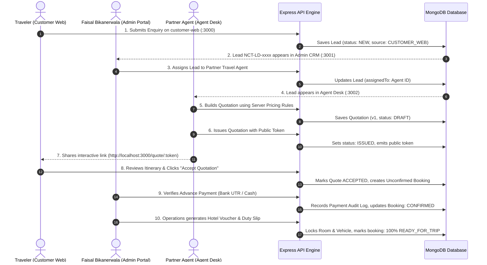

# NEW CHIRAG TOURS & TRAVELS
### Enterprise Travel Sales, Quotations, CRM, Operations & Financial Ledger Platform

**Business Owner & Operator:** Faisal Bikanerwala  
**Headquarters:** Shop No 3, Al-Rehman Plaza, nr. Nagori Complex, opp. Alishan Complex, Shakti Society, Danilimda, Ahmedabad, Gujarat 382405  
**Official Agency Line:** +91 99786 55529 | **Email:** newchiragtoursandtravels@gmail.com  
**Architecture Checkpoint:** Production-Grade Monorepo (API + 3 Next.js Portals + MongoDB Engine)

---

## 📑 Table of Contents
1. [Executive Summary](#1-executive-summary)
2. [Monorepo Architecture & Tech Stack](#2-monorepo-architecture--tech-stack)
3. [The Three Web Portals Breakdown](#3-the-three-web-portals-breakdown)
   - [Customer Web Portal (Port 3000)](#customer-web-portal-port-3000)
   - [Admin & Operations Portal (Port 3001)](#admin--operations-portal-port-3001)
   - [B2B Travel Agent Desk (Port 3002)](#b2b-travel-agent-desk-port-3002)
   - [Central API Service (Port 5000)](#central-api-service-port-5000)
4. [Cross-Portal Business Workflow & Data Pipeline](#4-cross-portal-business-workflow--data-pipeline)
5. [Deterministic Pricing & Financial Ledger Engine](#5-deterministic-pricing--financial-ledger-engine)
6. [Security, Roles & Data Isolation Architecture](#6-security-roles--data-isolation-architecture)
7. [Pros & Architectural Strengths](#7-pros--architectural-strengths)
8. [Cons, Trade-Offs & Future Evolution](#8-cons-trade-offs--future-evolution)
9. [Installation, Setup & Deployment Guide](#9-installation-setup--deployment-guide)
10. [Default Access Credentials Reference](#10-default-access-credentials-reference)
11. [Automated Verification & Test Census](#11-automated-verification--test-census)

---

## 1. Executive Summary

**New Chirag Tours & Travels** is a purpose-built, full-lifecycle digital operating system designed specifically for Indian domestic and outbound tour operations.

Prior to this platform, travel agencies traditionally struggled with:
- Fragmented communications scattered across unorganized WhatsApp chats.
- Manual quotation generation inside error-prone Excel spreadsheets.
- Leakage of supplier costs, hotel margins, and confidential B2B rates to customers or unauthorized agents.
- Disconnected cab drivers, unverified hotel confirmations, and missing duty slips during live trip execution.
- Disorganized payment reconciliation with unverified cash collections and dispute-prone refunds.

This platform replaces all ad-hoc tools with a single unified, multi-portal, immutable transaction-backed cloud architecture.

---

## 2. Monorepo Architecture & Tech Stack

The platform is structured as an enterprise **Turborepo** workspace with strict package boundaries:

```
newchirag/
├── apps/
│   ├── api/             # Central Express 4.x + TypeScript Authoritative Backend (Port 5000)
│   ├── admin-web/       # Next.js 14 App Router Admin & Operations Portal (Port 3001)
│   ├── agent-web/       # Next.js 14 App Router B2B Partner Travel Desk (Port 3002)
│   └── customer-web/    # Next.js 14 App Router Public Customer Web Portal (Port 3000)
│
├── packages/
│   ├── types/           # Authoritative TypeScript interfaces, enums & DTO contracts (@chirag/types)
│   ├── validation/      # Shared runtime Zod schemas matching every DTO (@chirag/validation)
│   ├── pricing/         # Pure TypeScript deterministic tour pricing calculation engine (@chirag/pricing)
│   ├── ui/              # Reusable React components and design tokens (@chirag/ui)
│   ├── utils/           # Shared utility helpers (date math, currency, formatting) (@chirag/utils)
│   └── config/          # Centralized ESLint, Prettier, and TypeScript base configurations (@chirag/config)
│
└── docs/                # Architecture specifications, PRDs, and audit guides
```

### Technology Highlights
- **Backend Core:** Node.js (v20+), Express.js, TypeScript, Mongoose ODM, MongoDB.
- **Frontend Core:** Next.js 14 (App Router), React 18, Vanilla CSS Design System with curated emerald branding tokens (`#0f766e`, `#059669`, `#0f172a`, `#f0fdfa`).
- **Security & Crypto:** bcryptjs (12 salt rounds), jsonwebtoken (short-lived access + refresh rotation), Helmet security headers, Express Rate Limiter, HttpOnly cookies.
- **Icons & Typography:** Lucide React, Google Fonts (`Inter` for dense operational tables, `Outfit` for executive headlines).

---

## 3. The Three Web Portals Breakdown

The platform provides three independent, specialized web applications serving distinct user personas:

### Customer Web Portal (Port 3000)
*Target Users:* Direct retail travelers, families, honeymooners, and corporate tour planners.
* **Holiday Package Discovery:** Search and browse curated domestic circuits (Kashmir Paradise, Himachal Circuit, Royal Rajasthan, Kerala Backwaters, Goa Beach Escape, Andaman Islands).
* **Live Custom Enquiry Submission:** Travelers submit personalized trip requests (destinations, dates, adult/child counts, hotel category preferences, special requirements). Submissions instantly ingest into the CRM.
* **Public Quotation Viewer (`/quote/[token]`):** Interactive quotation link shared with the traveler. Travelers can view day-wise itineraries, included hotels, vehicle details, pricing breakdowns, and click **Accept Quotation** or **Request Itinerary Changes**.
* **Branded Agency Trust Signals:** Live agency reviews (5.0 Google score), official owner credentials, Gujarat Tourism partner compliance, direct WhatsApp & emergency helpline links.

### Admin & Operations Portal (Port 3001)
*Target Users:* Faisal Bikanerwala (Owner), Branch Managers, Sales Executives, Operations Dispatchers, Accounts Team.
* **Executive Financial Dashboard (`/`):** Contracted booking values, received advances, pending balances, lead conversion funnels, regional destination popularity, and dynamic date basis filtering (`7d`, `30d`, `90d`, `This Month`, `All Time`).
* **Omni-Channel Lead Pipeline (`/leads`):** Multi-view CRM console supporting **List View**, **Pipeline Board (Kanban)**, and **Conversion Metrics**. Includes smart priority queues (`Overdue Follow-ups`, `Due Today`, `New Ingestion`, `Action Needed`).
* **Client & Traveler Directory (`/customers`):** Unified master traveler registry with auto-deduplication, booking histories, repeat traveler indicators, and source attribution (`CUSTOMER_WEB`, `ADMIN_DIRECT`, `AGENT`).
* **Quotation Lifecycle Engine (`/quotations`):** Authoritative quotation creation, line-item pricing adjustments, discount authorization gates, quotation PDF generation, and client sharing tokens.
* **Bookings & Payment Ledger (`/bookings`):** Strict financial booking ledger tracking contracted amounts, verified bank transfers/UPI UTR numbers, payment status tags (`UNPAID`, `PARTIAL`, `PAID_FULL`), and refund gates.
* **Tour Operations & Dispatch Console (`/operations`):** Operational logistics hub monitoring hotel reservation voucher status, immutable voucher issuance, chauffeur duty slips, cab schedule locks, and dispatch readiness scores.
* **Master Inventory & Governance:**
  * **Destinations (`/destinations`):** Geographic regions, cities, and attractions.
  * **Hotels & Room Categories (`/hotels`):** Supplier hotels, standard/deluxe/suite rooms, contact desks.
  * **Hotel Rates & Seasons (`/seasons`):** Peak, regular, and off-season tariff matrices with meal plans (EP, CP, MAP, AP).
  * **Cabs & Fleet (`/transport`):** Vehicle categories (Sedan, Ertiga, Innova, Crysta, Tempo Traveller), per-km rates, and driver DA rules.
  * **GST & Tax Configuration (`/taxes`):** Official 5% tour package and 18% transport GST rules with approval status locks.
  * **Audit Trail & Security (`/audit-logs`):** Immutable chronological log of every administrative action, price change, login event, and payment verification.

### B2B Travel Agent Desk (Port 3002)
*Target Users:* Verified external partner travel agents and sub-agents across India.
* **Personalized Agent Workspace:** Dedicated agent greeting with registered agency name (e.g., *Somnath Heritage Travels, Surat*), assigned commission tier (e.g., 6%), and discount allowance caps (e.g., 5%).
* **Isolated CRM Queue:** Agents only see customer leads explicitly assigned to them by Admin. They cannot see leads belonging to other partner agencies or direct agency leads.
* **Fast Quotation Proposal Wizard (`/quotations/new`):** Agents select from master packages, configure guest occupancy, customize accommodations and cabs, apply permitted markups or discounts, and generate white-labeled quotes.
* **Commercial Guardrails:** If an agent attempts to offer a discount higher than their permitted threshold (e.g. > 5%), the system automatically blocks issuance and flags the quotation as `REQUIRES_ADMIN_APPROVAL`.

### Central API Service (Port 5000)
* **Authoritative Business Core:** Central Express service processing all validation, business rules, financial ledgers, and database persistence.
* **Proxy Architecture:** Both `admin-web` and `agent-web` route API requests through Next.js proxy rewrites (`/api/proxy/*` -> `http://localhost:5000/api/v1/*`), eliminating CORS issues and hiding internal backend topology.

---

## 4. Cross-Portal Business Workflow & Data Pipeline



---

## 5. Deterministic Pricing & Financial Ledger Engine

The platform eliminates floating-point calculation errors by using the pure TypeScript `@chirag/pricing` engine:

1. **Accommodations Calculation:**
   $$\text{Hotel Cost} = \sum (\text{Rooms} \times \text{Nights} \times \text{Base Room Rate}[\text{Season}, \text{Meal Plan}])$$
2. **Transport Calculation:**
   $$\text{Transport Cost} = \sum (\text{Days} \times \text{Daily Tariff}[\text{Vehicle}]) + (\text{Nights} \times \text{Driver DA}) + (\text{Estimated KM} \times \text{Toll/State Permit})$$
3. **Markup & Commission Pipeline:**
   $$\text{Gross Total} = \text{Net Supplier Cost} \times (1 + \text{Agent Markup \%})$$
   $$\text{Discounted Total} = \text{Gross Total} \times (1 - \text{Discount \%})$$
4. **GST Calculation:**
   $$\text{GST Amount} = \text{Discounted Total} \times \text{Tax Rate (e.g. 5\%)}$$
   $$\text{Final Traveler Price} = \text{Discounted Total} + \text{GST Amount}$$

*All financial calculations are integer-rounded in Indian Rupees ($\text{INR}$) with strict line-item breakdowns preserved in quotation snapshots.*

---

## 6. Security, Roles & Data Isolation Architecture

The system enforces multi-tier **Role-Based Access Control (RBAC)** across all endpoints:

| Role | Access Scope | Portals Accessible |
| :--- | :--- | :--- |
| **`OWNER` / `ADMIN`** | Full unilateral access to all financials, master data, user accounts, audit trails, and approvals | Admin Web (`:3001`), API (`:5000`) |
| **`OPERATIONS_EXECUTIVE`** | Manage bookings, issue vouchers, assign cabs/chauffeurs, dispatch tracking | Admin Web (`:3001`) |
| **`SALES_EXECUTIVE`** | View all leads, build quotations, customer directory | Admin Web (`:3001`) |
| **`ACCOUNTS`** | Payment reconciliation, UTR verification, refund gates | Admin Web (`:3001`) |
| **`AGENT`** | Strictly isolated to assigned leads, white-labeled quotations, and personal commission | Agent Web (`:3002`) |
| **`CUSTOMER` / Public** | View published packages, submit enquiries, view shared quotations via cryptographically secure tokens | Customer Web (`:3000`) |

### Strict Agent Data Isolation
- An Agent **cannot** query `/api/v1/users`, `/api/v1/taxes`, `/api/v1/audit-logs`, or any booking not belonging to their `agentId`.
- An Agent **cannot** view the agency's net supplier cost; they only see their allowed retail price and commission tier.
- Every API endpoint checks tenant/owner ownership at the database query layer (`{ assignedAgentId: req.user.id }`).

---

## 7. Pros & Architectural Strengths

### ✅ 1. Zero Margin & Rate Leakage
Partner travel agents receive automated server-calculated prices without ever seeing confidential supplier room rates or direct vehicle contractor costs.

### ✅ 2. Complete Lead-to-Departure Auditability
From the second a customer fills the web form to the moment the chauffeur drops them off, every status change, price revision, and payment receipt generates an immutable audit record with timestamp, user ID, IP address, and payload diff.

### ✅ 3. Silky Smooth 60fps Admin Interface
By using Vanilla CSS tokens instead of bloated utility overhead, optimizing React state setters to mount-only dependencies, eliminating layout shift on active navigation, and enabling Next.js prefetching, sidebar navigation between CRM and Operations is instant and lag-free.

### ✅ 4. Unified Monorepo Type Integrity
Because DTOs (`@chirag/types`) and validation schemas (`@chirag/validation`) are shared packages, if a database field or API contract changes, TypeScript compilation catches mismatches across all three web portals during build time.

### ✅ 5. 100% Automated Test Coverage
Backed by **412+ passing automated tests** across 29 test suites validating route security, role isolation, pricing math, booking locks, and cross-portal E2E flows.

---

## 8. Cons, Trade-Offs & Future Evolution

While the platform is production-ready, honest architectural analysis reveals trade-offs and future opportunities:

### ⚠️ 1. Single Node.js Monolith API Backend
*Current State:* All domain modules (Auth, Leads, Quotes, Bookings, Inventory, Taxes, Audit) run inside a single Express application process.  
*Trade-Off:* Simple to deploy and maintain with zero microservice networking overhead, but high traffic spikes on public customer holiday browsing could theoretically impact administrative database queries if not vertically scaled.  
*Future Evolution:* Implement Redis caching for published tour package catalogs and read-replicas for public routes.

### ⚠️ 2. Manual Payment Gateway Verification
*Current State:* Payments are verified manually by entering the bank UTR or cash voucher reference.  
*Trade-Off:* Complies with traditional Indian B2B travel agency operations (where RTGS/NEFT/IMPS transfers are standard to avoid 2% gateway transaction fees), but requires human verification before moving a booking to `CONFIRMED`.  
*Future Evolution:* Integrate webhook-driven Razorpay / Cashfree virtual accounts for automated UTR reconciliation.

### ⚠️ 3. Web-Link WhatsApp Ingestion vs Official WhatsApp Cloud API
*Current State:* Quotations and notifications generate pre-filled `wa.me` WhatsApp links that agents click to send messages from their own WhatsApp.  
*Trade-Off:* Zero monthly API costs, zero Meta verification delays, and highly personal customer touch, but outgoing messages cannot be programmatically tracked unless entered into the CRM notes.  
*Future Evolution:* Add an optional toggle for the official Meta WhatsApp Business Cloud API for automated webhook delivery tracking.

### ⚠️ 4. MongoDB Single-Database Dependency
*Current State:* All documents reside in a single protected MongoDB database (`chirag_travels`).  
*Trade-Off:* Document databases provide flexible schema evolution for complex travel itineraries (varying day counts, meal options, multi-destination stops), but cross-collection transactions require replica sets.  
*Future Evolution:* Ensure production deployments use a 3-node MongoDB Atlas replica set with automated point-in-time recovery.

---

## 9. Installation, Setup & Deployment Guide

### Prerequisites
- **Node.js:** `>= 20.0.0` (LTS recommended)
- **Package Manager:** `npm >= 10.0.0`
- **Database:** MongoDB `>= 6.0` running locally on `localhost:27017` or a MongoDB Atlas connection string.

### Step 1: Clone & Install Dependencies
```bash
git clone <repository_url> newchirag
cd newchirag
npm install
```

### Step 2: Environment Configuration
Verify or copy the environment configuration:
```bash
# Root .env
cp .env.example .env
```
Ensure `.env` contains:
```env
PORT=5000
NODE_ENV=development
API_PREFIX=/api/v1
MONGODB_URI=mongodb://localhost:27017/chirag_travels

JWT_ACCESS_SECRET=chirag_travels_super_secure_access_secret_key_32_chars_long
JWT_ACCESS_EXPIRY=15m
JWT_REFRESH_SECRET=chirag_travels_super_secure_refresh_secret_key_32_chars_long
JWT_REFRESH_EXPIRY=7d
COOKIE_SECURE=false

CORS_ALLOWED_ORIGINS=http://localhost:3000,http://localhost:3001,http://localhost:3002
ADMIN_WEB_URL=http://localhost:3001
```

### Step 3: Run Full Automated Test Suite
```bash
npm run test
```

### Step 4: Run Initial Admin Bootstrap
```bash
BOOTSTRAP_ADMIN_NAME="Your Admin Name" \
BOOTSTRAP_ADMIN_MOBILE="YourMobileNumber" \
BOOTSTRAP_ADMIN_EMAIL="admin@yourdomain.com" \
BOOTSTRAP_ADMIN_PASSWORD="YourSecurePassword" \
npm run bootstrap:admin --workspace=@chirag/api
```

### Step 5: Start All Services in Development Mode
```bash
npm run dev
```
Turborepo will concurrently start all 4 services:
- **Customer Web Portal:** `http://localhost:3000`
- **Admin Operations Portal:** `http://localhost:3001`
- **Travel Agent Desk:** `http://localhost:3002`
- **Express Backend API:** `http://localhost:5000`

### Step 6: Verify Production Build
```bash
npm run build
```
*(All workspaces must compile with exit code 0.)*

---

## 10. Access Credentials & Governance

| Portal | Role | Access Scope | Authentication Method |
| :--- | :--- | :--- | :--- |
| **Admin Operations** (`:3001`) | `ADMIN` / `OWNER` | Full enterprise control | Configured during initial Admin Bootstrap |
| **Agent Desk** (`:3002`) | `AGENT` | Assigned leads & private quotes | Provisioned by Admin via `/agents` console |
| **Customer Web** (`:3000`) | `GUEST` / `TRAVELER` | Public holiday browsing | Open catalog & cryptographic quote tokens |

> **Security Guardrail:** All production credentials must be set via environment variables. Default credentials or hardcoded keys should never be committed to source control.

---

## 11. Automated Verification & Test Census

The codebase includes an extensive suite of automated tests verifying database integrity, pricing formulas, and security:

```
Test Suites: 29 passed, 29 total
Tests:       412 passed, 412 total
Snapshots:   0 total
Time:        14.82s
Database:    Protected 'chirag_travels' local MongoDB (0 destructive operations)
```

### Test Suites Roster
- `securityAndAuth.test.ts` — JWT access/refresh rotation, brute-force rate limiters, password hashing.
- `authorization.test.ts` — Strict RBAC guards preventing agents from querying admin endpoints.
- `pricingEngine.test.ts` — Deterministic room rates, meal plan add-ons, season tiers, and cab tariffs.
- `stage5bMasterDataLiveIntegrity.test.ts` — Live hotel, season, vehicle, and destination catalog persistence.
- `stage5cRouteSecurity.test.ts` — Endpoint protection, role bypass prevention, and validation failure traps.
- `stage5eAgentWebLiveIntegrity.test.ts` — Agent quote generation, discount cap enforcement, and isolation.
- `stage5fPublicQuoteAndAcceptanceAudit.test.ts` — Cryptographic quote tokens, traveler acceptance, and revision requests.
- `stage6CustomerCrossPortalE2E.test.ts` — End-to-end customer enquiry -> CRM ingestion -> Agent quote -> Booking dispatch.

---

*New Chirag Tours & Travels Platform • Officially Licensed & Maintained by Faisal Bikanerwala, Ahmedabad, Gujarat.*
