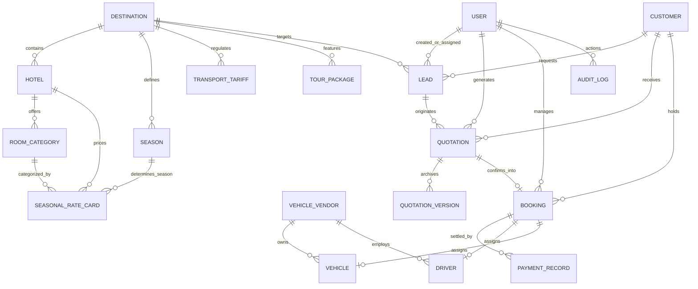
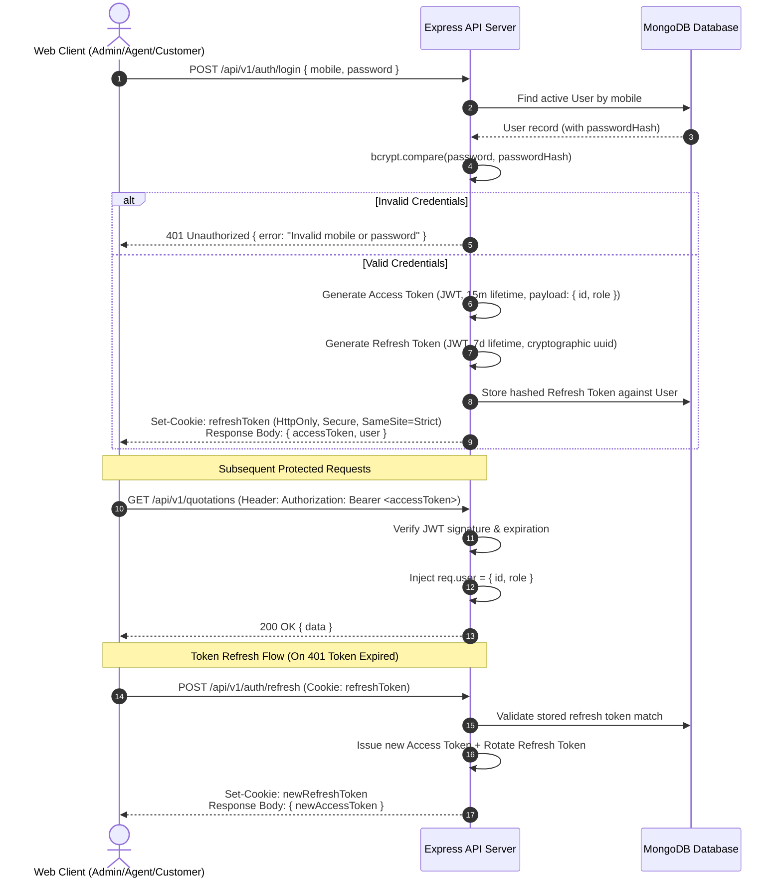
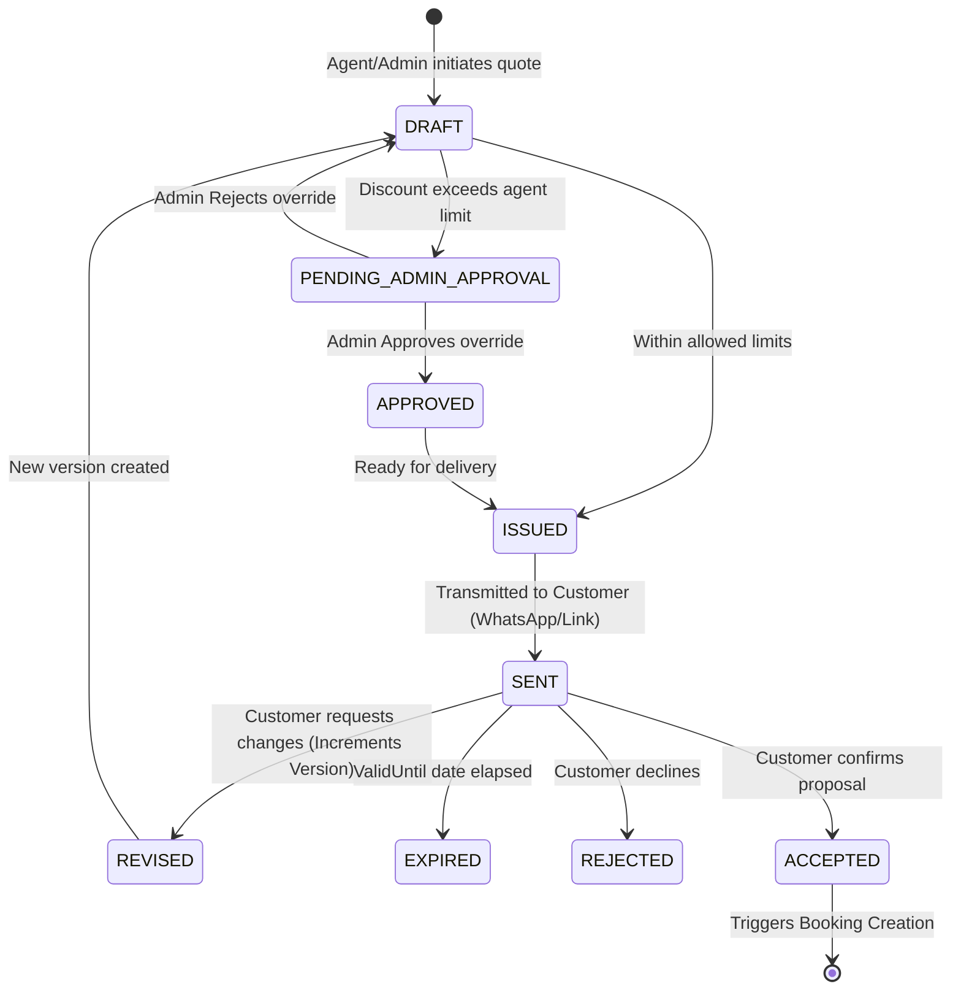
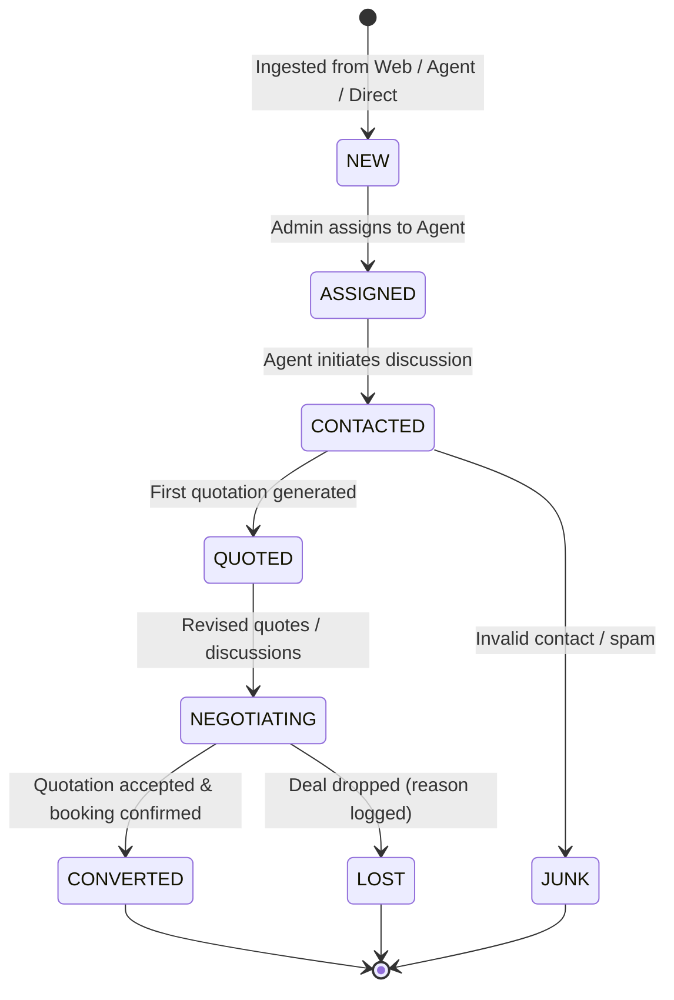
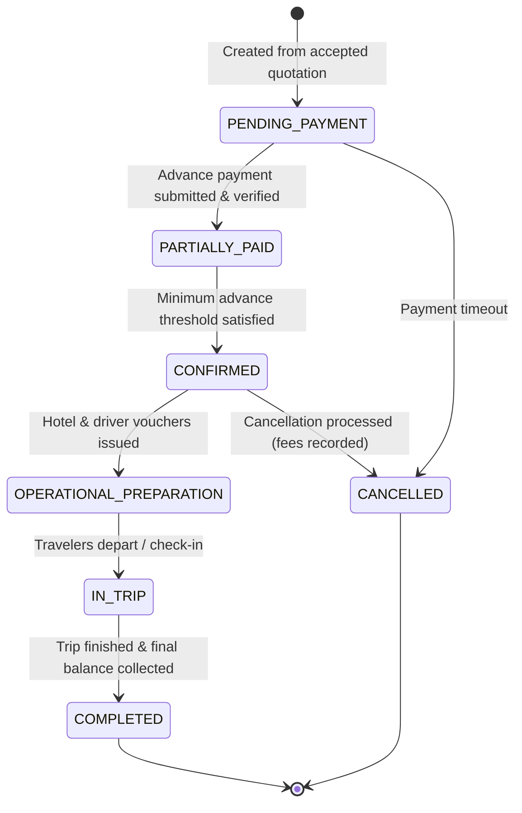

# NEW CHIRAG TOURS & TRAVELS
## Production Architecture & System Design Document (Phase 0)

**Project:** NEW CHIRAG TOURS & TRAVELS  
**Business Owner:** Faisal Bikanerwala  
**Author:** Antigravity Engineering  
**Version:** 1.0.0 (Production Architecture Baseline)  
**Status:** Approved for Foundation & Phase 1 Execution  

---

## Table of Contents
1. [Final Monorepo Directory & Codebase Structure](#1-final-monorepo-directory--codebase-structure)
2. [Technology Decisions & Stack Matrix](#2-technology-decisions--stack-matrix)
3. [Application Boundaries & Communication Patterns](#3-application-boundaries--communication-patterns)
4. [Database Entity Map & Schema Specifications](#4-database-entity-map--schema-specifications)
5. [Entity Relationship Diagram](#5-entity-relationship-diagram)
6. [Authentication Architecture](#6-authentication-architecture)
7. [Role-Based Access Control (RBAC) Architecture](#7-role-based-access-control-rbac-architecture)
8. [Pricing Architecture Proposal](#8-pricing-architecture-proposal)
9. [Quotation Lifecycle State Machine](#9-quotation-lifecycle-state-machine)
10. [Lead Lifecycle State Machine](#10-lead-lifecycle-state-machine)
11. [Booking Lifecycle State Machine](#11-booking-lifecycle-state-machine)
12. [Agent, Customer & Admin Data Ownership Rules](#12-agent-customer--admin-data-ownership-rules)
13. [API Architecture & REST Specifications](#13-api-architecture--rest-specifications)
14. [Shared Package Strategy](#14-shared-package-strategy)
15. [Environment Variable Strategy](#15-environment-variable-strategy)
16. [Development Phases Overview](#16-development-phases-overview)
17. [Testing Strategy](#17-testing-strategy)
18. [Security Checklist & Compliance Standards](#18-security-checklist--compliance-standards)
19. [Deployment Architecture Proposal](#19-deployment-architecture-proposal)
20. [Architectural Decision Records (ADRs)](#20-architectural-decision-records-adrs)

---

## 1. Final Monorepo Directory & Codebase Structure

We employ an industry-standard TypeScript monorepo driven by **Turborepo** with npm/pnpm workspaces. This enforces strict separation of concerns, zero code duplication, unified linting/typechecking, and granular build pipelines.

```
/
├── apps/
│   ├── api/                     # Central Node.js / Express / TypeScript REST API
│   │   ├── src/
│   │   │   ├── config/          # Environment validation, database connections, cors, rate limits
│   │   │   ├── constants/       # Enums, standard status codes, error dictionaries
│   │   │   ├── controllers/     # HTTP request handling, response orchestration
│   │   │   ├── middlewares/     # Auth, RBAC, error handling, rate limiting, request context
│   │   │   ├── models/          # Mongoose database models and schema definitions
│   │   │   ├── repositories/    # Data access layer for query isolation & transactions
│   │   │   ├── routes/          # Express route definitions grouped by domain
│   │   │   ├── services/        # Core business logic (pricing, quotation, booking, lead)
│   │   │   ├── utils/           # Server-side utilities (logger, tokens, audit emitter)
│   │   │   ├── app.ts           # Express application setup
│   │   │   └── server.ts        # Server entrypoint with graceful shutdown
│   │   ├── package.json
│   │   └── tsconfig.json
│   │
│   ├── admin-web/               # Next.js 14+ App Router Portal for Faisal Bikanerwala & Ops
│   │   ├── src/
│   │   │   ├── app/             # App Router pages (auth, dashboard, inventory, leads, quotes, bookings, reports)
│   │   │   ├── components/      # Admin UI components (tables, filters, charts, drawers, forms)
│   │   │   ├── hooks/           # Custom React hooks (useAuth, useLeads, useQuotations)
│   │   │   ├── lib/             # API client, TanStack Query client, date formatters
│   │   │   └── store/           # Client-side UI state (sidebar, preferences)
│   │   ├── package.json
│   │   └── tsconfig.json
│   │
│   ├── agent-web/               # Next.js 14+ App Router Portal for Chirag Network Travel Agents
│   │   ├── src/
│   │   │   ├── app/             # App Router pages (login, my-leads, quote-builder, my-bookings, performance)
│   │   │   ├── components/      # Rapid quotation builder, customer intake forms, itinerary viewer
│   │   │   ├── hooks/           # Agent-scoped data fetching hooks
│   │   │   └── lib/             # API client & local helpers
│   │   ├── package.json
│   │   └── tsconfig.json
│   │
│   └── customer-web/            # Next.js 14+ App Router Public Facing Website & Discovery Portal
│       ├── src/
│       │   ├── app/             # App Router pages (home, destinations, packages, quote-view, contact)
│       │   ├── components/      # Hero banners, package cards, inquiry modal, itinerary viewer
│       │   ├── hooks/           # Inquiries, package discovery hooks
│       │   └── lib/             # Public API client
│       ├── package.json
│       └── tsconfig.json
│
├── packages/
│   ├── types/                   # Shared TypeScript models, DTOs, API payloads & enums
│   │   ├── src/
│   │   │   ├── auth.ts
│   │   │   ├── user.ts
│   │   │   ├── lead.ts
│   │   │   ├── customer.ts
│   │   │   ├── destination.ts
│   │   │   ├── hotel.ts
│   │   │   ├── vehicle.ts
│   │   │   ├── package.ts
│   │   │   ├── season.ts
│   │   │   ├── quotation.ts
│   │   │   ├── booking.ts
│   │   │   ├── payment.ts
│   │   │   ├── audit.ts
│   │   │   └── index.ts
│   │   ├── package.json
│   │   └── tsconfig.json
│   │
│   ├── validation/              # Shared Zod validation schemas for API inputs & frontend forms
│   │   ├── src/
│   │   │   ├── auth.schema.ts
│   │   │   ├── lead.schema.ts
│   │   │   ├── quotation.schema.ts
│   │   │   ├── booking.schema.ts
│   │   │   ├── hotel.schema.ts
│   │   │   ├── vehicle.schema.ts
│   │   │   └── index.ts
│   │   ├── package.json
│   │   └── tsconfig.json
│   │
│   ├── pricing/                 # Pure TypeScript deterministic pricing calculation engine
│   │   ├── src/
│   │   │   ├── calculator.ts    # Room rates, seasonal adjustments, vehicle tariffs, tax computation
│   │   │   ├── seasonResolver.ts# Date-to-season deterministic mapping & priority resolver
│   │   │   ├── taxEngine.ts     # Indian GST rules calculation
│   │   │   └── index.ts
│   │   ├── package.json
│   │   └── tsconfig.json
│   │
│   ├── ui/                      # Shared design system components (buttons, badges, inputs, dialogs)
│   │   ├── src/
│   │   │   ├── components/
│   │   │   └── index.ts
│   │   ├── package.json
│   │   └── tsconfig.json
│   │
│   ├── config/                  # Shared configurations (ESLint, Prettier, Tailwind base config)
│   │   ├── eslint/
│   │   ├── tailwind/
│   │   └── tsconfig/
│   │
│   └── utils/                   # Shared utility helpers (currency formatting, date calculations, slugify)
│       ├── src/
│       │   ├── currency.ts      # Indian Rupees (INR) formatting (Lakhs / Crores)
│       │   ├── dates.ts         # Nights calculation, date range formatters
│       │   └── index.ts
│       ├── package.json
│       └── tsconfig.json
│
├── docs/                        # Master system documentation
│   ├── ARCHITECTURE.md          # This comprehensive architecture document
│   ├── PRODUCT_REQUIREMENTS.md  # Detailed business PRD
│   └── IMPLEMENTATION_ROADMAP.md# Phase-by-phase execution guide
│
├── .env.example                 # Central template for all environment configurations
├── .gitignore                   # Monorepo git ignore definitions
├── turbo.json                   # Turborepo task pipeline definitions
├── package.json                 # Monorepo root workspace configuration
└── README.md                    # Project overview and developer onboarding
```

---

## 2. Technology Decisions & Stack Matrix

| Domain | Technology Chosen | Rationale & Justification |
| :--- | :--- | :--- |
| **Monorepo Manager** | **Turborepo** + npm workspaces | High-speed incremental caching, clear dependency graphs, zero-overhead task execution across apps and packages. |
| **Backend Framework** | **Node.js (v20 LTS) + Express + TypeScript** | Battle-tested, lightweight, event-driven HTTP architecture. Provides total control over middleware chains, audit hooks, and streaming without serverless execution timeout limits. |
| **Frontend Framework** | **Next.js 14+ (App Router) + React 18/19** | Industry standard for modern web portals. Provides fast client navigation, server-side SEO for the Customer Web, and rich UI interactivity for Admin & Agent apps. |
| **Language** | **TypeScript 5.x** (Strict mode) | End-to-end type safety spanning backend database models, validation schemas, shared calculation engines, and frontend viewmodels. |
| **Database** | **MongoDB (v7+) with Mongoose (v8+)** | Highly expressive document store ideal for complex, versioned hierarchical structures (itineraries, quotations with day-wise room and transport lines, audit logs). Strongly indexed for relational-style consistency. |
| **Validation** | **Zod (v3+)** | Single source of truth for runtime validation and static TypeScript inference. Shared between backend API input parsing and frontend React Hook Form resolvers. |
| **Styling** | **Tailwind CSS (v3+)** | Utility-first CSS framework enabling consistent, tokenized styling, responsive typography, and mobile-first layouts without style leakage. |
| **UI Components** | **Radix UI Primitives / Headless UI patterns** | High accessibility (a11y), zero unstyled bloat, clean keyboard navigation for high-speed agent/admin workflows. |
| **State & Data Fetching**| **TanStack Query (v5)** | Intelligent caching, automatic background refetching, mutation states, and optimistic updates across web portals. |
| **Forms** | **React Hook Form** | High performance, un-opinionated form state management with direct Zod schema resolver integration. |
| **Security & Auth** | **bcryptjs + jsonwebtoken + helmet** | Industry-standard password hashing, dual-token JWT rotation (short-lived access token + HTTP-only secure cookie refresh token), and standard HTTP security headers. |

---

## 3. Application Boundaries & Communication Patterns

```
                                  +-----------------------------+
                                  |     End Traveler Device     |
                                  +--------------+--------------+
                                                 |
                                                 v
                                  +-----------------------------+
                                  |    CUSTOMER WEB PORTAL      |
                                  |      (Next.js App)          |
                                  +--------------+--------------+
                                                 | HTTPS / JSON (Public endpoints)
                                                 v
+-----------------------+         +-----------------------------+         +-----------------------+
|    ADMIN WEB PORTAL   |         |      CENTRAL REST API       |         |   AGENT WEB PORTAL    |
| (Faisal Bikanerwala)  | ------> |    (Express + TypeScript)   | <------ | (Network Travel Desk) |
|     (Next.js App)     | HTTPS   |  /api/v1/auth, leads, quotes|  HTTPS  |     (Next.js App)     |
+-----------------------+         +--------------+--------------+         +-----------------------+
                                                 |
                                                 | Mongoose ODM / TLS
                                                 v
                                  +-----------------------------+
                                  |     CENTRAL DATABASE        |
                                  |      (MongoDB Atlas)        |
                                  +-----------------------------+
```

### Communication Rules & Boundary Enforcement:
1. **Single Source of Truth:** All data mutations and financial computations are executed strictly by the `api` service. Frontend applications are presentation layers that call the API.
2. **Domain Layer Independence:** Business logic (such as pricing math, validation rules, and permission checks) is housed in pure TypeScript packages (`@chirag/pricing`, `@chirag/validation`) imported by the backend API.
3. **No Cross-Portal Leaks:**
   - The **Customer Web** only has access to public inquiry creation and read-only customer quotation view endpoints. Customer endpoints never return base supplier costs, markup amounts, or agent identities.
   - The **Agent Web** only has access to agent-scoped endpoints. The API automatically attaches `agentId = req.user.id` to every query, preventing agents from inspecting or mutating competitor agents' records.
   - The **Admin Web** possesses full operational and managerial endpoint access, protected by `requireRole('ADMIN')`.

---

## 4. Database Entity Map & Schema Specifications

The MongoDB schema uses normalized entity references (`ObjectId`) for relational integrity, combined with structured subdocuments for immutable transaction snapshots (e.g., preserving itemized room rates at the moment a quotation version was locked).

### 4.1 Master Entities

#### `User`
- `_id`: ObjectId
- `fullName`: String (Required, indexed)
- `email`: String (Unique, sparse, lowercased)
- `mobile`: String (Required, unique, indexed; supports 10-digit Indian numbers and E.164 international phone formats)
- `passwordHash`: String (Selected false by default)
- `role`: Enum `['ADMIN', 'AGENT', 'CUSTOMER']`
- `status`: Enum `['ACTIVE', 'INACTIVE', 'SUSPENDED']`
- `agentProfile`: Subdocument (Optional, populated when `role === 'AGENT'`)
  - `agencyName`: String
  - `city`: String
  - `maxDiscountPercent`: Number (Default: 5)
  - `maxMarkupPercent`: Number (Default: 20)
  - `canApproveFinalPrice`: Boolean (Default: false)
  - `commissionRatePercent`: Number
- `refreshTokenHash`: String (Nullable)
- `createdAt`, `updatedAt`: Timestamps

#### `Destination`
- `_id`: ObjectId
- `name`: String (e.g., "Kashmir", "Goa", "Himachal Pradesh", unique, indexed)
- `slug`: String (Unique, indexed)
- `country`: String (Default: "India")
- `state`: String
- `region`: Enum `['NORTH', 'SOUTH', 'EAST', 'WEST', 'CENTRAL', 'NORTH_EAST', 'ISLANDS', 'INTERNATIONAL']`
- `description`: String
- `coverImages`: Array of Strings
- `highlights`: Array of Strings
- `isActive`: Boolean (Default: true)
- `createdAt`, `updatedAt`: Timestamps

#### `Hotel`
- `_id`: ObjectId
- `name`: String (Required, indexed)
- `destinationId`: ObjectId (Ref: `Destination`, indexed)
- `starRating`: Number (1–5)
- `propertyType`: Enum `['HOTEL', 'RESORT', 'HOUSEBOAT', 'HOMESTAY', 'LUXURY_CAMP', 'HERITAGE_HAVELI']`
- `address`: String
- `city`: String
- `contactPhone`: String
- `contactEmail`: String
- `vendorName`: String (Contracted supplier / Hotelier group)
- `amenities`: Array of Strings
- `images`: Array of Strings
- `checkInTime`: String (e.g., "14:00")
- `checkOutTime`: String (e.g., "11:00")
- `isActive`: Boolean (Default: true)
- `createdAt`, `updatedAt`: Timestamps

#### `RoomCategory`
- `_id`: ObjectId
- `hotelId`: ObjectId (Ref: `Hotel`, indexed)
- `name`: String (e.g., "Deluxe Room", "Super Deluxe Lake View", "Suite")
- `baseOccupancy`: Number (Default: 2)
- `maxAdults`: Number (Default: 3)
- `maxChildren`: Number (Default: 2)
- `totalRooms`: Number
- `isActive`: Boolean (Default: true)

#### `SeasonalRateCard` (Hotel Room Pricing)
- `_id`: ObjectId
- `hotelId`: ObjectId (Ref: `Hotel`, indexed)
- `roomCategoryId`: ObjectId (Ref: `RoomCategory`, indexed)
- `seasonId`: ObjectId (Ref: `Season`, indexed)
- `mealPlan`: Enum `['RO', 'CP', 'MAP', 'AP']`
- `baseCostPerNight`: Number (Cost paid to hotelier)
- `extraAdultBedCost`: Number
- `childWithBedCost`: Number
- `childWithoutBedCost`: Number
- `standardSellingPrice`: Number (Recommended retail price before dynamic markup)
- `validFrom`: Date
- `validTo`: Date
- `isActive`: Boolean (Default: true)

#### `Season`
- `_id`: ObjectId
- `name`: String (e.g., "Goa Super Peak 2026", "Kashmir Summer Regular")
- `seasonType`: Enum `['REGULAR', 'PEAK', 'OFF_SEASON', 'FESTIVAL', 'SUPER_PEAK']`
- `destinationId`: ObjectId (Ref: `Destination`, indexed)
- `startDate`: Date (Indexed)
- `endDate`: Date (Indexed)
- `priority`: Number (Default: 10, higher number takes precedence on overlaps)
- `description`: String

#### `VehicleVendor`
- `_id`: ObjectId
- `businessName`: String (e.g., "Kashmir Valley Transporters", indexed)
- `contactPerson`: String
- `phone`: String (Required)
- `city`: String
- `settlementTerms`: String
- `bankAccountDetails`: Subdocument
- `isActive`: Boolean (Default: true)

#### `Vehicle`
- `_id`: ObjectId
- `vendorId`: ObjectId (Ref: `VehicleVendor`, indexed)
- `model`: String (e.g., "Innova Crysta", "Swift Dzire", "Tempo Traveller 12-Seater")
- `category`: Enum `['HATCHBACK', 'SEDAN', 'SUV', 'PREMIUM_SUV', 'TEMPO_TRAVELLER', 'BUS']`
- `registrationNumber`: String (Unique, indexed)
- `seatingCapacity`: Number
- `hasAC`: Boolean (Default: true)
- `insuranceExpiry`: Date
- `fitnessExpiry`: Date
- `status`: Enum `['AVAILABLE', 'ON_TRIP', 'MAINTENANCE', 'INACTIVE']`

#### `Driver`
- `_id`: ObjectId
- `vendorId`: ObjectId (Ref: `VehicleVendor`, indexed)
- `assignedVehicleId`: ObjectId (Ref: `Vehicle`, Nullable)
- `fullName`: String (Required)
- `mobile`: String (Required, indexed)
- `licenseNumber`: String (Required)
- `licenseExpiry`: Date
- `languages`: Array of Strings
- `status`: Enum `['ACTIVE', 'ON_DUTY', 'OFF_DUTY', 'BLACKLISTED']`

#### `TransportTariff`
- `_id`: ObjectId
- `destinationId`: ObjectId (Ref: `Destination`, indexed)
- `vehicleCategory`: Enum `['HATCHBACK', 'SEDAN', 'SUV', 'PREMIUM_SUV', 'TEMPO_TRAVELLER', 'BUS']`
- `seasonType`: Enum `['REGULAR', 'PEAK', 'OFF_SEASON', 'FESTIVAL', 'SUPER_PEAK']`
- `tariffType`: Enum `['PER_DAY', 'PER_KM', 'FIXED_CIRCUIT']`
- `circuitName`: String (e.g., "Srinagar - Gulmarg - Pahalgam - Srinagar 5D")
- `baseSupplierCost`: Number (Cost owed to transporter)
- `driverDailyAllowanceCost`: Number (Driver Bhatta)
- `standardSellingRate`: Number
- `includedKmPerDay`: Number
- `extraKmRate`: Number
- `extraHourRate`: Number
- `isTollParkingIncluded`: Boolean (Default: false)

#### `TourPackage`
- `_id`: ObjectId
- `title`: String (e.g., "5N/6D Enchanting Kashmir Family Vacation", indexed)
- `slug`: String (Unique, indexed)
- `destinationId`: ObjectId (Ref: `Destination`, indexed)
- `durationNights`: Number
- `durationDays`: Number
- `overview`: String
- `dayWiseItinerary`: Array of Subdocuments
  - `dayNumber`: Number
  - `title`: String
  - `description`: String
  - `nightStayDestination`: String
  - `mealsIncluded`: Array of Strings
  - `activities`: Array of Strings
- `inclusions`: Array of Strings
- `exclusions`: Array of Strings
- `termsAndConditions`: Array of Strings
- `cancellationPolicy`: Array of Strings
- `featuredImage`: String
- `galleryImages`: Array of Strings
- `isPublished`: Boolean (Default: true)
- `createdAt`, `updatedAt`: Timestamps

---

### 4.2 Transactional & CRM Entities

#### `Customer`
- `_id`: ObjectId
- `fullName`: String (Required, indexed)
- `mobile`: String (Required, indexed)
- `email`: String (Optional, indexed)
- `city`: String
- `state`: String
- `notes`: String
- `source`: Enum `['ADMIN_DIRECT', 'CUSTOMER_WEB', 'CUSTOMER_APP', 'AGENT', 'PHONE', 'WALK_IN', 'OTHER']`
- `createdBy`: ObjectId (Ref: `User`)
- `assignedAgentId`: ObjectId (Ref: `User`, Nullable, indexed)
- `createdAt`, `updatedAt`: Timestamps

#### `Lead`
- `_id`: ObjectId
- `leadNumber`: String (Unique, formatted: `NCT-LD-YYYY-XXXXX`)
- `customerId`: ObjectId (Ref: `Customer`, Required, indexed)
- `destinationId`: ObjectId (Ref: `Destination`, Required, indexed)
- `packageId`: ObjectId (Ref: `TourPackage`, Optional)
- `tentativeTravelDate`: Date
- `durationNights`: Number
- `numberOfAdults`: Number
- `numberOfChildren`: Number
- `budgetEstimate`: Number (Optional)
- `specialRequirements`: String
- `source`: Enum `['ADMIN_DIRECT', 'CUSTOMER_WEB', 'CUSTOMER_APP', 'AGENT', 'PHONE', 'WALK_IN', 'OTHER']`
- `status`: Enum `['NEW', 'ASSIGNED', 'CONTACTED', 'QUOTED', 'NEGOTIATING', 'CONVERTED', 'LOST', 'JUNK']`
- `assignedAgentId`: ObjectId (Ref: `User`, Nullable, indexed)
- `assignedBy`: ObjectId (Ref: `User`, Nullable)
- `assignedAt`: Date
- `lostReason`: String (Optional)
- `createdBy`: ObjectId (Ref: `User`)
- `createdAt`, `updatedAt`: Timestamps

#### `Quotation`
- `_id`: ObjectId
- `quoteNumber`: String (Unique, formatted: `NCT-QT-YYYY-XXXXX`, indexed)
- `leadId`: ObjectId (Ref: `Lead`, Required, indexed)
- `customerId`: ObjectId (Ref: `Customer`, Required, indexed)
- `assignedAgentId`: ObjectId (Ref: `User`, Required, indexed)
- `destinationId`: ObjectId (Ref: `Destination`, Required, indexed)
- `packageId`: ObjectId (Ref: `TourPackage`, Optional)
- `travelStartDate`: Date (Required)
- `travelEndDate`: Date (Required)
- `durationNights`: Number
- `durationDays`: Number
- `numberOfAdults`: Number
- `numberOfChildren`: Number
- `numberOfInfants`: Number
- `currentVersion`: Number (Default: 1)
- `status`: Enum `['DRAFT', 'PENDING_ADMIN_APPROVAL', 'APPROVED', 'ISSUED', 'SENT', 'ACCEPTED', 'REVISED', 'EXPIRED', 'REJECTED']`
- `shareableToken`: String (Unique cryptographic token for customer-web public view)
- `validUntil`: Date (Required, indexed)
- `notes`: String
- `inclusions`: Array of Strings
- `exclusions`: Array of Strings
- `terms`: Array of Strings
- `pricingSummary`: Subdocument (Reflects current active version)
  - `totalBaseSupplierCost`: Number
  - `totalMarkupAmount`: Number
  - `markupPercent`: Number
  - `discountAmount`: Number
  - `discountPercent`: Number
  - `taxableAmount`: Number
  - `gstRatePercent`: Number (e.g., 5% on travel packages)
  - `gstAmount`: Number
  - `finalSellingPrice`: Number
  - `projectedGrossProfit`: Number
- `approvedBy`: ObjectId (Ref: `User`, Nullable)
- `approvedAt`: Date
- `createdBy`: ObjectId (Ref: `User`)
- `createdAt`, `updatedAt`: Timestamps

#### `QuotationVersion` (Immutable Historical Snapshots)
- `_id`: ObjectId
- `quotationId`: ObjectId (Ref: `Quotation`, Required, indexed)
- `versionNumber`: Number (Required)
- `snapshotData`: Object (Complete serialized state of hotel lines, transport lines, day-wise calculations, and financial breakdown at time of locking)
- `createdBy`: ObjectId (Ref: `User`)
- `changeReason`: String
- `createdAt`: Date

#### `Booking`
- `_id`: ObjectId
- `bookingNumber`: String (Unique, formatted: `NCT-BK-YYYY-XXXXX`, indexed)
- `quotationId`: ObjectId (Ref: `Quotation`, Required, indexed)
- `quotationVersionUsed`: Number
- `leadId`: ObjectId (Ref: `Lead`, Required, indexed)
- `customerId`: ObjectId (Ref: `Customer`, Required, indexed)
- `assignedAgentId`: ObjectId (Ref: `User`, Required, indexed)
- `destinationId`: ObjectId (Ref: `Destination`, Required)
- `travelStartDate`: Date (Indexed)
- `travelEndDate`: Date
- `status`: Enum `['PENDING_PAYMENT', 'PARTIALLY_PAID', 'CONFIRMED', 'OPERATIONAL_PREPARATION', 'IN_TRIP', 'COMPLETED', 'CANCELLED']`
- `financials`: Subdocument
  - `totalAmount`: Number (Final agreed selling price)
  - `advanceRequired`: Number
  - `totalPaid`: Number (Default: 0)
  - `balancePending`: Number
  - `supplierCostTotal`: Number
  - `realizedGrossProfit`: Number
- `operations`: Subdocument
  - `hotelVoucherGenerated`: Boolean (Default: false)
  - `hotelVoucherUrl`: String
  - `driverDutySlipGenerated`: Boolean (Default: false)
  - `driverDutySlipUrl`: String
  - `assignedDriverId`: ObjectId (Ref: `Driver`, Nullable)
  - `assignedVehicleId`: ObjectId (Ref: `Vehicle`, Nullable)
- `cancellationReason`: String (Nullable)
- `cancellationFee`: Number (Default: 0)
- `confirmedBy`: ObjectId (Ref: `User`, Nullable)
- `confirmedAt`: Date
- `createdAt`, `updatedAt`: Timestamps

#### `PaymentRecord` (Manual Verification Ledger)
- `_id`: ObjectId
- `bookingId`: ObjectId (Ref: `Booking`, Required, indexed)
- `receiptNumber`: String (Unique, formatted: `NCT-RCP-YYYY-XXXXX`, indexed)
- `amount`: Number (Required)
- `paymentType`: Enum `['ADVANCE', 'PARTIAL', 'FINAL_BALANCE', 'REFUND']`
- `paymentMethod`: Enum `['UPI', 'NEFT_IMPS', 'BANK_DEPOSIT', 'CASH', 'CHEQUE']`
- `transactionReference`: String (UTR / Transaction ID / Slip No, indexed)
- `paymentDate`: Date (Required)
- `proofDocumentUrl`: String (Uploaded slip / screenshot)
- `status`: Enum `['SUBMITTED', 'VERIFIED', 'REJECTED']`
- `verifiedBy`: ObjectId (Ref: `User`, Nullable)
- `verifiedAt`: Date
- `rejectionReason`: String (Nullable)
- `recordedBy`: ObjectId (Ref: `User`)
- `createdAt`, `updatedAt`: Timestamps

#### `AuditLog`
- `_id`: ObjectId
- `actorId`: ObjectId (Ref: `User`, Required, indexed)
- `actorRole`: Enum `['ADMIN', 'AGENT', 'CUSTOMER']`
- `action`: String (e.g., `QUOTATION_PRICE_OVERRIDE`, `LEAD_REASSIGNED`, `PAYMENT_VERIFIED`)
- `entityType`: Enum `['LEAD', 'QUOTATION', 'BOOKING', 'PAYMENT', 'HOTEL', 'TARIFF', 'USER', 'SETTINGS']`
- `entityId`: ObjectId (Indexed)
- `ipAddress`: String
- `userAgent`: String
- `previousState`: Object (Nullable)
- `newState`: Object
- `notes`: String
- `timestamp`: Date (Default: `Date.now`, indexed)

---

## 5. Entity Relationship Diagram



---

## 6. Authentication Architecture

The system uses a hardened, dual-token JSON Web Token (JWT) architecture designed for security, CSRF protection, and role integrity.



### Security Rules:
1. **Password Hashing:** `bcryptjs` with salt round cost factor `12`.
2. **Access Token:** Stored in client memory (React state / TanStack cache), short expiration (15 minutes).
3. **Refresh Token:** Stored in `HttpOnly`, `Secure`, `SameSite=Strict` cookie, 7-day expiration. Automatic sliding rotation on every refresh request. Revoked immediately on logout.
4. **No Fallback Logins:** Under no circumstances will mock logins, automatic bypasses, or hardcoded master passwords exist.

---

## 7. Role-Based Access Control (RBAC) Architecture

Access control is enforced strictly on the backend through layered Express middleware:
1. `authenticateToken`: Validates JWT signature, injects `req.user`.
2. `requireRole(...allowedRoles)`: Restricts routes to specified roles.
3. `enforceAgentOwnership`: Validates that agents only query/mutate documents where `assignedAgentId === req.user.id`.

### RBAC Permission Matrix

| Resource / Action | ADMIN | AGENT | CUSTOMER |
| :--- | :---: | :---: | :---: |
| **System Settings & User Management** | Full CRUD | None | None |
| **Master Data (Destinations, Hotels, Tariffs)**| Full CRUD | Read-Only | Read-Only (Public subsets) |
| **View Net Supplier Costs (Base Cost)** | Read | **Denied** | **Denied** |
| **Lead Pool (All Leads)** | Full Access | **Denied** | **Denied** |
| **Leads (Self-Created / Assigned)** | Full Access | Read / Update | None |
| **Quotation Creation & Editing** | Full Access | Allowed (Within margin limits) | None |
| **Approve Quotation Price Overrides** | Allowed | **Denied** | **Denied** |
| **Customer Quotation View** | Read | Read (Self-quotes) | Read (Token-scoped) |
| **Manual Payment Verification** | Full Approve/Reject | Submit Proof Only | Submit Proof Only |
| **Driver & Vehicle Allocation (Operations)** | Full Access | Read-Only | View Assigned Vehicle Details |
| **Gross Profit & Business Analytics** | Full Access | Own Sales/Commission only | **Denied** |
| **System Audit Logs** | Read-Only | **Denied** | **Denied** |

---

## 8. Pricing Architecture Proposal

Pricing calculations are strictly isolated within the `@chirag/pricing` shared package. **Frontends NEVER calculate financial totals independently.**

### 8.1 The Core Pricing Formula

$$\text{Total Base Supplier Cost} = \sum (\text{Room Base Cost} \times \text{Nights} \times \text{Rooms}) + \text{Extra Bed Cost} + \text{Transport Supplier Cost}$$

$$\text{Markup Amount} = \text{Base Cost} \times \frac{\text{Markup Percent}}{100}$$

$$\text{Gross Selling (Pre-Discount)} = \text{Base Cost} + \text{Markup Amount}$$

$$\text{Net Taxable Amount} = \text{Gross Selling} - \text{Discount Amount}$$

$$\text{Tax Amount} = \begin{cases} \text{Net Taxable Amount} \times \frac{\text{Tax Rate Percent}}{100} & \text{if Tax Applicable} \\ 0 & \text{if Exempt / Zero-Rated} \end{cases}$$

$$\text{Final Customer Selling Price} = \text{Net Taxable Amount} + \text{Tax Amount}$$

$$\text{Projected Gross Profit} = \text{Net Taxable Amount} - \text{Total Base Supplier Cost}$$

*(Note: Taxes collected are governmental liabilities, not business gross profit. Tax calculation is driven dynamically via backend-managed `TaxRule` configurations, supporting GST, international VAT, and authorized zero-rated exemptions.)*


### 8.2 Agent Financial Guardrails
When an Agent builds a quotation:
1. The backend evaluates the agent's permissions in `user.agentProfile`.
2. If `requestedDiscountPercent > agent.maxDiscountPercent`:
   - The quotation status is forced to `PENDING_ADMIN_APPROVAL`.
   - The quote cannot be sent to the customer until Faisal Bikanerwala approves the override.
3. If `requestedMarkupPercent < agent.minMarkupPercent`:
   - The quotation status is rejected or flagged for supervisor authorization to protect minimum margins.

---

## 9. Quotation Lifecycle State Machine



---

## 10. Lead Lifecycle State Machine



---

## 11. Booking Lifecycle State Machine



---

## 12. Agent, Customer & Admin Data Ownership Rules

1. **Row-Level Query Scoping:**
   ```typescript
   // In Lead / Quotation / Booking repositories:
   const buildAccessFilter = (user: AuthenticatedUser) => {
     if (user.role === 'ADMIN') return {}; // Global visibility
     if (user.role === 'AGENT') return { assignedAgentId: user.id }; // Scoped visibility
     if (user.role === 'CUSTOMER') return { customerId: user.id }; // Customer visibility
     throw new ForbiddenException();
   };
   ```
2. **Field-Level Data Masking (Sanitization Pipeline):**
   ```typescript
   // Serialization transform for non-admin callers:
   const sanitizeQuotationForResponse = (quote: IQuotation, role: Role) => {
     if (role === 'ADMIN') return quote;
     const sanitized = { ...quote.toObject() };
     delete sanitized.pricingSummary.totalBaseSupplierCost;
     delete sanitized.pricingSummary.projectedGrossProfit;
     delete sanitized.supplierLineItems;
     return sanitized;
   };
   ```
3. **Customer Isolation:**
   - Customers have no login-less access to internal records.
   - Quotation public links use high-entropy random hashes (`shareableToken`), with rate limiting and expiration enforcement.

---

## 13. API Architecture & REST Specifications

### Standardized Response Envelope
All API endpoints return a uniform JSON envelope:
```json
{
  "success": true,
  "data": { ... },
  "error": null,
  "meta": {
    "page": 1,
    "limit": 20,
    "total": 142,
    "timestamp": "2026-10-08T18:55:00.000Z"
  }
}
```

### Error Response Envelope
```json
{
  "success": false,
  "data": null,
  "error": {
    "code": "VALIDATION_FAILED",
    "message": "Input validation failed on provided fields.",
    "details": [
      { "field": "mobile", "issue": "Invalid Indian mobile number format" }
    ]
  },
  "meta": {
    "timestamp": "2026-10-08T18:55:00.000Z"
  }
}
```

### API Routing Hierarchy (`/api/v1`)
- `/api/v1/auth` (login, logout, refresh, me, change-password)
- `/api/v1/users` (Admin: agent list, create agent, permissions update)
- `/api/v1/destinations` (CRUD destinations, image management)
- `/api/v1/hotels` (Hotels, room categories, seasonal rate cards)
- `/api/v1/vehicles` (Vendors, fleet, drivers, tariffs)
- `/api/v1/seasons` (Seasonal calendar rules, date queries)
- `/api/v1/packages` (Ready-made tour packages)
- `/api/v1/leads` (CRM leads, ingestion, status updates, agent assignment)
- `/api/v1/customers` (Customer profiles, search, booking history)
- `/api/v1/quotations` (Create, version, price calculation, approval, PDF render)
- `/api/v1/bookings` (Confirmations, operational vouchers, driver duty slips)
- `/api/v1/payments` (Submit manual receipt, verify, audit)
- `/api/v1/reports` (Admin & Agent real-time transaction-backed performance)
- `/api/v1/audit-logs` (Admin system audit trail)

---

## 14. Shared Package Strategy

| Package Name | Purpose | Consumers |
| :--- | :--- | :--- |
| `@chirag/types` | TypeScript interfaces, enums, DTOs, API contracts | `api`, `admin-web`, `agent-web`, `customer-web`, `@chirag/pricing` |
| `@chirag/validation` | Zod schemas for request validation & form handling | `api`, `admin-web`, `agent-web`, `customer-web` |
| `@chirag/pricing` | Deterministic pricing calculator, seasonal priority resolver, GST math | `api`, `admin-web` (preview), `agent-web` (preview) |
| `@chirag/ui` | Shared design tokens, primitives, responsive layout wrappers | `admin-web`, `agent-web`, `customer-web` |
| `@chirag/utils` | Pure functions for dates, INR currency formatting, slug generators | All apps & packages |
| `@chirag/config` | Shared ESLint configurations, Tailwind presets, TSConfigs | All apps & packages |

---

## 15. Environment Variable Strategy

A single `.env.example` file documents all configuration variables. Secrets are loaded via process environment variables and strictly validated at server startup using Zod in `apps/api/src/config/env.ts`.

```bash
# Server Environment
PORT=5000
NODE_ENV=development
API_PREFIX=/api/v1

# Database
MONGODB_URI=mongodb://localhost:27017/chirag_travels

# Security & Authentication
JWT_ACCESS_SECRET=your_jwt_access_secret_min_32_chars
JWT_ACCESS_EXPIRY=15m
JWT_REFRESH_SECRET=your_jwt_refresh_secret_min_32_chars
JWT_REFRESH_EXPIRY=7d
CORS_ALLOWED_ORIGINS=http://localhost:3000,http://localhost:3001,http://localhost:3002

# Asset Management (Future Phase Integration)
CLOUDINARY_CLOUD_NAME=
CLOUDINARY_API_KEY=
CLOUDINARY_API_SECRET=
```

---

## 16. Development Phases Overview

- **Phase 0:** Architecture, System Design, PRD, Roadmap, & Monorepo Foundation (Current Phase)
- **Phase 1:** Monorepo Workspace Configuration, Shared Packages & Core Express API Foundation
- **Phase 2:** Master Data & Inventory Management (Destinations, Hotels, Vehicles, Drivers, Tariffs, Seasons, Packages)
- **Phase 3:** Deterministic Seasonal Pricing Engine & Quotation System
- **Phase 4:** CRM, Lead Ingestion & Agent Assignment Engine
- **Phase 5:** Booking Engine, Manual Payment Ledger & Operations Management
- **Phase 6:** Admin Web Portal Development (Faisal Bikanerwala Control Center)
- **Phase 7:** Agent Web Portal Development (Fast Quote & Desk CRM)
- **Phase 8:** Customer Web Portal Development (Discovery & Public Quotes)
- **Phase 9:** Real-Time Analytics, Performance Reporting & Gross Profit Audit
- **Phase 10:** Production Hardening, Security Audit & Launch Preparation

---

## 17. Testing Strategy

1. **Unit Testing (`vitest`):**
   - `@chirag/pricing`: 100% test coverage for complex multi-night seasonal rate resolutions, child bed math, and GST calculations.
   - `@chirag/validation`: Testing all Zod schemas against valid and edge-case invalid payloads.
2. **Integration Testing (`supertest` + In-Memory MongoDB):**
   - REST API endpoint verification for auth flows, RBAC restrictions, and data sanitization pipelines.
3. **End-to-End Testing (`playwright`):**
   - Walk-in to Quotation flow in Agent Web.
   - Lead assignment and profit auditing in Admin Web.
   - Customer public quote review on mobile viewports.

---

## 18. Security Checklist & Compliance Standards

- [x] **No Hardcoded Credentials:** Verified zero plain-text secrets in repository.
- [x] **Password Protection:** Minimum 12 rounds bcrypt salt; no plain passwords in logs or responses.
- [x] **JWT Hygiene:** Short-lived access tokens (15m), HttpOnly SameSite=Strict cookies for refresh tokens.
- [x] **Injection Defense:** Mongoose parameter binding prevents NoSQL injection; Zod sanitizes incoming payloads.
- [x] **HTTP Headers:** Helmet integration for Content Security Policy, XSS filter, and frameguard.
- [x] **Rate Limiting:** IP-based and user-based limits on login and quote calculation endpoints.
- [x] **Audit Trail:** Immutable audit log for financial overrides, role changes, and booking confirmations.
- [x] **CORS Restrictiveness:** Whitelisted frontend origins only.

---

## 19. Deployment Architecture Proposal

```
                    +---------------------------+
                    | Cloudflare / DNS / WAF    |
                    +-------------+-------------+
                                  |
                +-----------------+-----------------+
                |                                   |
                v                                   v
+-------------------------------+   +-------------------------------+
| Vercel / Node Web Hosting     |   | Containerized Node Service    |
| - admin.chiragtravels.com     |   | - api.chiragtravels.com       |
| - agent.chiragtravels.com     |   |   (AWS ECS / DigitalOcean /   |
| - chiragtravels.com           |   |    Render Docker runtime)     |
+-------------------------------+   +---------------+---------------+
                                                    |
                                                    v
                                    +-------------------------------+
                                    | MongoDB Atlas Cluster         |
                                    | (M10+ Multi-AZ Replica Set)   |
                                    +-------------------------------+
```

---

## 20. Architectural Decision Records (ADRs)

### ADR 001: Monorepo Orchestration with Turborepo
- **Context:** System requires three distinct frontends and a central API sharing core pricing math, types, and schemas.
- **Decision:** Use Turborepo with npm/pnpm workspaces.
- **Consequence:** Code reuse across packages with fast cached builds; zero duplication of Zod validation or pricing formulas.

### ADR 002: Standalone Express API over Next.js API Routes
- **Context:** Three web frontends plus a future Flutter mobile app must consume the exact same backend logic.
- **Decision:** Dedicated Node.js Express TypeScript API service (`apps/api`).
- **Consequence:** Clean decoupling. The mobile app and all web apps interact identically with the API. Server processes can run long background jobs, PDF rendering, and socket events without serverless execution limitations.

### ADR 003: Central Deterministic Pricing Engine Package
- **Context:** Travel margins are vulnerable to pricing discrepancies if frontends calculate subtotals independently.
- **Decision:** Build `@chirag/pricing` as a pure, dependency-free TypeScript library. Frontends only display preview estimates returned by the backend, which executes authoritative calculations.
- **Consequence:** 100% auditability and mathematical consistency across all platforms.

### ADR 004: Manual Payment Verification for Phase 1
- **Context:** Travel package payments in India are primarily high-ticket bank transfers (NEFT/RTGS/IMPS/UPI) rather than credit card transactions with 2% gateway fees.
- **Decision:** Support manual proof upload (UTR number + screenshot) with Admin verification workflows before integrating automated payment gateways.
- **Consequence:** Eliminates premature gateway transaction fees and simplifies launch compliance.

### ADR 005: Normalized Relational Modeling in MongoDB
- **Context:** Hotels, transport tariffs, and seasons change over time, but historical bookings and quotations must remain immutable.
- **Decision:** Use normalized `ObjectId` references for inventory masters, combined with frozen snapshot subdocuments inside `QuotationVersion` and `Booking`.
- **Consequence:** Master data updates do not corrupt historical quotes; historical audit records remain tamper-proof.

---

*End of Architecture Document.*
