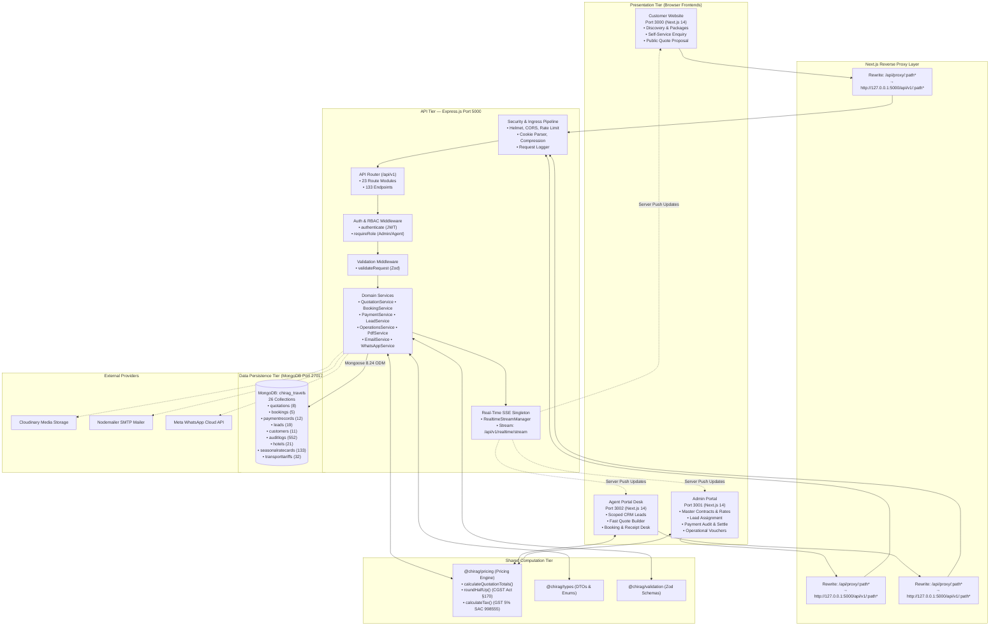

# NEW CHIRAG TOURS AND TRAVELS — COMPLETE TECHNICAL AUDIT & RECONNAISSANCE REPORT
**Audit Execution Date:** 5 November 2026  
**Auditor Roles:** Principal Software Architect, Senior Full-Stack Engineer, Database Architect, DevOps Engineer, QA Lead, Security Auditor  
**Target Codebase:** New Chirag Tours and Travels Enterprise Monorepo (`Newchirag`)  
**Scope & Mode:** Non-Destructive Code & Database Reconnaissance (Strictly Audit-Only, Zero Mutations, Zero Package Changes)  
**Report Destination:** `docs/COMPLETE_PROJECT_TECHNICAL_AUDIT_2026-11-05.md`  

---

## 1. Executive Summary

### 1.1 Architectural Verdict
The **New Chirag Tours and Travels** system is an enterprise-grade, highly cohesive full-stack travel booking and agency management platform. Built as a unified TypeScript monorepo using **Turborepo**, **Next.js 14**, **Express 4.22**, and **MongoDB with Mongoose 8.24**, the architecture cleanly separates concerns across three distinct presentation portals (Customer Website, Admin Portal, Agent Portal) backed by a centralized REST API gateway and a deterministic pricing engine.

Development progress is substantial and functionally mature. Core multi-tenant business flows—including customer self-service enquiries, lead lifecycle tracking, agent quotation generation, central GST-compliant pricing calculation, public tokenized proposal presentation, booking conversion, multi-receipt payment tracking in paise-integer precision, and operational vouchers—are fully implemented in code and backed by 26 live database collections.

However, while core functionality is largely complete, the platform exhibits critical operational friction points and technical debt that cause developer confusion, UI inconsistencies, and production deployment risks if left unaddressed. This audit provides an unvarnished, line-by-line inspection of the current repository state.

### 1.2 Core Strengths
1. **Deterministic Pricing Engine (`@chirag/pricing`):** Monetary calculations are decoupled from UI and database layers into an isolated package. It enforces **Standard Commercial Half-Up Rounding** (Section 170 CGST Act compliance) and Banker's Rounding, supports dual % and Flat ₹ markups/discounts, and dynamically resolves GST rules without floating-point IEEE-754 drift.
2. **Integer Monetary Ledger in Database:** `BookingFinancials` and `PaymentRecord` store every financial figure in both decimal Rupees and integer **Paise** (`amountInPaise`, `totalAmountInPaise`, `totalPaidInPaise`, `balancePendingInPaise`), preventing rounding discrepancies and ledger drift.
3. **High-Entropy Tokenized Public Quotations:** Public proposal links do not leak MongoDB ObjectIds or customer PII. They use 256-bit cryptographically secure tokens (`crypto.randomBytes(32).toString("hex")`) whose SHA-256 hashes are stored in the database. When an agent revises a quotation, old hashes are moved to `supersededTokenHashes`, cleanly preventing stale or unauthorized booking acceptances.
4. **Real-time Synchronization Singleton (`useRealtimeSync`):** Cross-portal state coordination uses Server-Sent Events (SSE) via `/api/v1/realtime/stream` with a client-side window singleton (`RealtimeStreamManager`). This eliminates browser tab socket exhaustion, debounces burst events, and purges in-memory client caches upon server pushes.
5. **Zero-Error Workspace TypeScript Compilation:** All 9 packages and applications (`@chirag/types`, `@chirag/validation`, `@chirag/pricing`, `@chirag/utils`, `@chirag/ui`, `@chirag/api`, `@chirag/customer-web`, `@chirag/admin-web`, `@chirag/agent-web`) compile with **0 TypeScript errors** when checked against their respective workspace configurations.

### 1.3 Critical Gaps and Vulnerabilities
1. **Root TypeScript Configuration Gap:** Running `npx tsc --noEmit` from the repository root fails because the root `tsconfig.json` extends Node configuration and lacks `"jsx": "preserve"` and DOM library bindings required by Next.js apps.
2. **Destructive Integration Test Hazard:** 9 test files in `apps/api/test` (e.g. `stage5bMasterDataLiveIntegrity.test.ts`, `stage6CustomerCrossPortalE2E.test.ts`) invoke `deleteMany({})` directly on models without enforcing an isolated test database URI (`chirag_travels_test`), creating a severe risk of data wiping if `npm test` is run indiscriminately against the local development database.
3. **HTML-Only Proposal Streaming (Pseudo-PDF):** Backend endpoints `/api/v1/quotations/public/:token/pdf` and `/api/v1/quotations/:id/pdf` return HTML documents with `Content-Type: text/html` and embedded CSS print media styles rather than binary `application/pdf` streams rendered via headless Chrome. Users rely on client-side browser print dialogs.
4. **Environment Port Inconsistencies:** The template `.env.example` defines `ADMIN_WEB_URL=http://localhost:3000`, `AGENT_WEB_URL=http://localhost:3001`, `CUSTOMER_WEB_URL=http://localhost:3002`, which conflicts with the actual live Next.js configurations (`Customer: 3000`, `Admin: 3001`, `Agent: 3002`).
5. **Simulated External Messaging in Local Environment:** Nodemailer SMTP and Meta WhatsApp Cloud API credentials are placeholders in local `.env`, defaulting to console logging.
6. **Missing Automated CI/CD & Deployment Configurations:** No GitHub Actions workflow (`.github/workflows`), Dockerfiles, or container orchestration manifests exist in the repository.

### 1.4 Production Readiness Scorecard
| Evaluation Dimension | Score (1-10) | Status | Assessment |
|---|:---:|:---:|---|
| **Architecture & Modularity** | 9 / 10 | EXCELLENT | Clean monorepo structure, shared libraries, decoupled services. |
| **Database Design & Integrity** | 9 / 10 | EXCELLENT | 26 normalized models, integer paise financial fields, compound indexes. |
| **Pricing & Financial System** | 9.5 / 10 | EXCEPTIONAL | CGST Act half-up rounding, dual markup modes, immutable snapshots. |
| **Backend API Breadth** | 9 / 10 | EXCELLENT | 133 endpoints covering all operational and master data requirements. |
| **Portal UI Implementation** | 8.5 / 10 | VERY GOOD | 42 routes across 3 portals, custom luxury CSS, recent dialog fixes. |
| **Security & Authorization** | 8.5 / 10 | VERY GOOD | Bcrypt (12 rounds), JWT access/refresh rotation, scoped agent queries. |
| **Real-Time Synchronization** | 9 / 10 | EXCELLENT | SSE multiplexing singleton preventing reload fatigue across portals. |
| **PDF & Document Engine** | 6.5 / 10 | ADEQUATE | Elegant HTML print templates, but lacks server-side binary PDF compilation. |
| **DevOps & CI/CD Readiness** | 4 / 10 | NEEDS ATTENTION | No containerization, missing GitHub Actions, environment port drift. |
| **Automated Test Isolation** | 6 / 10 | NEEDS ATTENTION | 47 unit tests pass; integration tests lack memory-server or isolated DB guard. |
| **OVERALL PRODUCTION READINESS** | **8.0 / 10** | **STRONG FOUNDATION** | **Ready for staging deployment once CI/CD and PDF renderer are established.** |

## 2. Current Project Snapshot

- **Project Name:** `new-chirag-tours-and-travels` (New Chirag Tours and Travels Monorepo)
- **Audit Snapshot Timestamp:** 5 November 2026, 21:55 IST
- **Repository Location:** `C:\Users\mo.mastur\Desktop\Newchirag`
- **Node.js Active Runtime:** `v24.11.0` (LTS baseline: Node 20+)
- **Package Manager:** `npm@11.6.1` with native workspaces enabled
- **Monorepo Build Orchestrator:** `Turbo 2.11.7` (`turbo.json`)
- **Database Status:** Local MongoDB Community Server running at `mongodb://localhost:27017/chirag_travels` (26 live collections, 552 audit logs, 8 quotations, 5 bookings, 11 customers)

### Active Applications & Assigned Ports
| Application | Workspace Name | Framework | Port | Local URL | Role / Purpose |
|---|---|---|:---:|---|---|
| **Customer Website** | `@chirag/customer-web` | Next.js 14.2.35 | `3000` | `http://localhost:3000` | Public travel discovery, package catalog, custom holiday enquiry planner, and interactive quotation proposal viewing (`/quote/[token]`). |
| **Admin Portal** | `@chirag/admin-web` | Next.js 14.2.35 | `3001` | `http://localhost:3001` | Executive agency back-office: master rates, hotel contracts, transport tariffs, seasonal rules, tax configuration, agent performance, lead assignment, payment verification, and audit logs. |
| **Agent Portal** | `@chirag/agent-web` | Next.js 14.2.35 | `3002` | `http://localhost:3002` | Travel consultant desk: scoped CRM leads, Fast Quote Builder, margin/discount adjustment within authorized caps, quote revision, and booking management. |
| **Backend API Gateway** | `@chirag/api` | Express 4.22.3 | `5000` | `http://localhost:5000/api/v1` | Central REST API and SSE stream provider servicing all three portals. |

## 3. Complete Repository Structure

The monorepo follows an enterprise Turborepo layout dividing code into `apps/` (runnable server and web targets) and `packages/` (shared libraries).

```
Newchirag/
├── .env                           # Root environment file
├── .env.example                   # Baseline environment template
├── package.json                   # Root workspace manifest (Turbo, Prettier, Puppeteer-core)
├── package-lock.json              # Canonical lockfile
├── tsconfig.json                  # Root tsconfig (path mappings for monorepo packages)
├── turbo.json                     # Turborepo task pipeline (build, lint, test, dev)
├── docs/                          # Architecture blueprints, roadmaps, and audit reports
│   ├── ARCHITECTURE.md
│   ├── IMPLEMENTATION_ROADMAP.md
│   ├── PRODUCT_REQUIREMENTS.md
│   └── COMPLETE_PROJECT_TECHNICAL_AUDIT_2026-11-05.md
│
├── apps/
│   ├── admin-web/                 # Admin Back-Office Web App (Next.js 14, Port 3001)
│   │   ├── next.config.js         # Next rewrites (/api/proxy/* -> API:5000)
│   │   ├── package.json
│   │   ├── tsconfig.json
│   │   └── src/
│   │       ├── app/               # Next.js App Router (19 routes)
│   │       ├── components/        # Admin UI widgets, Modals, Tables, Forms
│   │       ├── hooks/             # useRealtimeSync singleton
│   │       └── lib/               # api.ts (with 30s cache), branding.ts, labels.ts
│   │
│   ├── agent-web/                 # Partner Agent Travel Desk (Next.js 14, Port 3002)
│   │   ├── next.config.js         # Next rewrites (/api/proxy/* -> API:5000)
│   │   ├── package.json
│   │   ├── tsconfig.json
│   │   └── src/
│   │       ├── app/               # Next.js App Router (11 routes)
│   │       ├── components/        # Agent UI widgets, Fast Quote Builder, Modals
│   │       ├── hooks/             # useRealtimeSync singleton
│   │       └── lib/               # api.ts, branding.ts, labels.ts
│   │
│   ├── customer-web/              # Public Customer Portal (Next.js 14, Port 3000)
│   │   ├── next.config.js         # Next rewrites (/api/proxy/* -> API:5000)
│   │   ├── package.json
│   │   ├── tsconfig.json
│   │   └── src/
│   │       ├── app/               # Next.js App Router (12 routes)
│   │       ├── components/        # Hero, DestinationCards, UnifiedBookingCard, Modals
│   │       ├── hooks/             # useRealtimeSync singleton
│   │       └── lib/               # api.ts, branding.ts, utils.ts
│   │
│   └── api/                       # Express REST API Server (Port 5000)
│       ├── package.json
│       ├── tsconfig.json
│       ├── vitest.config.ts       # Unit and integration test runner config
│       ├── test/                  # 35 test suites covering auth, pricing, leads, bookings
│       └── src/
│           ├── config/            # env.ts (Zod validation), constants, cors, company
│           ├── constants/         # Error codes, permissions
│           ├── controllers/       # 20 Express route controllers
│           ├── middlewares/       # authenticate, authorize, errorHandler, rateLimiter, requestLogger
│           ├── models/            # 26 Mongoose schema models
│           ├── repositories/      # Data access layer (user, auditLog, etc.)
│           ├── routes/            # 23 Express router modules (133 endpoints)
│           ├── scripts/           # Seeding, admin bootstrapping, and live verification scripts
│           ├── services/          # Business logic (quotation, booking, payment, pdf, realtime, whatsapp, email)
│           ├── utils/             # appError, token.utils, date helpers
│           ├── app.ts             # Express app builder
│           └── server.ts          # Server entry point
│
└── packages/
    ├── config/                    # Shared ESLint, Prettier, and TypeScript base configs
    ├── pricing/                   # Precision Pricing Engine (@chirag/pricing)
    │   ├── package.json
    │   ├── tsconfig.json
    │   └── src/
    │       ├── calculator.ts      # Core quotation calculation algorithm
    │       ├── rounding.ts        # Half-up (CGST Act) & Banker's rounding
    │       ├── taxEngine.ts       # GST rules & breakdown computation
    │       ├── hotelPricing.ts    # Room night & meal plan pricing resolution
    │       ├── transportPricing.ts# Per-day & per-km tariff calculations
    │       └── seasonResolver.ts  # Seasonal date matching engine
    ├── types/                     # Shared TypeScript DTOs, Enums, and Interfaces (@chirag/types)
    ├── validation/                # Shared Zod validation schemas (@chirag/validation)
    ├── ui/                        # Shared UI primitives (@chirag/ui)
    └── utils/                     # Shared formatters, currency, and date helpers (@chirag/utils)
```

## 4. Complete Technology Stack & Exact Versions

All version numbers listed below are extracted directly from the canonical lockfile (`package-lock.json`) and active package configurations:

### 4.1 Frontend Technology Stack
- **Framework:** Next.js `14.2.35` (App Router architecture, React Server Components enabled, dynamic client rendering)
- **React Runtime:** React `18.3.1` and React DOM `18.3.1`
- **Language:** TypeScript `5.9.3`
- **Styling System:** Modern Native CSS with CSS Custom Properties / Design Tokens (`globals.css`). **No Tailwind CSS or PostCSS configuration is present.** Styling uses scoped luxury themes (`--primary: #059669`, `--navy: #0B192C`, `--card-bg: #ffffff`, `--font-sans: "Inter", system-ui`).
- **Icons:** Lucide React `0.378.0`
- **State Management:** React `useState`, `useRef`, and `useEffect` with localized custom hooks (`useRealtimeSync`).
- **Client Data Caching:** Custom in-memory client cache (`Map<string, ClientCacheEntry>`) with a 10s to 30s TTL across all three portals, dynamically invalidated on real-time SSE push events.
- **Forms & Validation:** Controlled React components validated client-side against shared Zod schemas (`@chirag/validation` v`3.25.76`).
- **PDF & Printing:** Native browser print stylesheets (`@media print`) and server-generated printer-ready HTML documents with embedded CSS rules.

### 4.2 Backend Technology Stack
- **Runtime:** Node.js `v24.11.0` (LTS baseline)
- **Web Framework:** Express.js `4.22.3`
- **Language & Execution:** TypeScript `5.9.3` executed in development via `tsx 4.23.15` with hot reload watch.
- **Validation:** Zod `3.25.76` executing in `validateRequest` middleware to validate `req.params`, `req.query`, and `req.body`.
- **Authentication:** JSON Web Tokens via `jsonwebtoken 9.0.3` (15m/24h access tokens) and `bcryptjs 2.4.3` (12 salt rounds).
- **Security Middleware:**
  - `helmet 7.2.0` (Content Security Policy, Cross-Origin Embedder Policy disabled for image assets)
  - `cors 2.8.6` (Configured with credentials support and regex matching for local origins)
  - `express-rate-limit 7.5.1` (General API limiter on `/api/v1`)
  - `cookie-parser 1.4.7` (Secure HTTP-only refresh token cookies)
  - `compression 1.8.2` (Gzip/Deflate response compression)
- **File Storage:** `cloudinary 2.11.0` SDK integration plus local disk fallback under `/uploads`.
- **Email Client:** `nodemailer 10.1.7` with fallback to simulated dispatch.
- **AI Assistant Integration:** `@google/genai 2.32.0` with `gemini-3.5-flash`.

### 4.3 Database Technology Stack
- **Database Engine:** MongoDB Community Server (v7.0/v8.0 local instance)
- **Object Data Modeling (ODM):** Mongoose `8.24.5`
- **Connection Mode:** `mongoose.connect(MONGODB_URI, { autoIndex: true })`
- **Collections:** 26 registered collections (see Section 10 for complete audit)
- **Transactions:** Mongoose sessions implemented in booking and financial settlement services.

### 4.4 Tooling and Monorepo Infrastructure
- **Orchestrator:** Turborepo `2.11.7`
- **Package Manager:** `npm@11.6.1`
- **Test Framework:** `vitest 1.6.1` and `supertest 7.3.1`
- **Clean Utility:** `rimraf 5.0.10`
- **Code Formatter:** `prettier 3.9.9`

## 5. System Architecture Diagram

The following diagram illustrates the complete topology, request flow, and data isolation between portals, the backend API gateway, the pricing engine, and the persistence tier:



## 6. Customer Website Audit (`apps/customer-web`)

- **Application Directory:** `apps/customer-web`
- **Assigned Runtime Port:** `3000` (`http://localhost:3000`)
- **Routing Architecture:** Next.js 14 App Router under `src/app/`
- **Total Registered Pages:** 12 routes
- **Total Major Components:** 16 UI components

### 6.1 Route Inventory & Implementation Status
| Route | Source File | Purpose | Data Source | Implementation Status |
|---|---|---|---|:---:|
| `/` | `src/app/page.tsx` | Main Homepage: curated packages, destinations grid, brand hero, testimonials | Live API (`/api/proxy/destinations`, `/api/proxy/packages`) | **COMPLETE** |
| `/destinations` | `src/app/destinations/page.tsx` | Full destinations catalog with state/region filters | Live API (`/api/proxy/destinations`) | **COMPLETE** |
| `/destinations/[slug]` | `src/app/destinations/[slug]/page.tsx` | Dynamic destination details page with associated packages | Live API (`/api/proxy/destinations/slug/:slug`) | **COMPLETE** |
| `/packages` | `src/app/packages/page.tsx` | Package listing with search, duration, and budget filtering | Live API (`/api/proxy/packages`) | **COMPLETE** |
| `/packages/[slug]` | `src/app/packages/[slug]/page.tsx` | Detailed package itinerary with day-by-day plan and inclusions | Live API (`/api/proxy/packages/slug/:slug`) | **COMPLETE** |
| `/enquiry` | `src/app/enquiry/page.tsx` | Custom holiday enquiry submission form | Live API (`POST /api/proxy/leads/public/enquiry`) | **COMPLETE** |
| `/plan` | `src/app/plan/page.tsx` | Step-by-step interactive trip planner wizard | Live API (`POST /api/proxy/leads/public/enquiry`) | **COMPLETE** |
| `/quote/[token]` | `src/app/quote/[token]/page.tsx` | Interactive luxury travel proposal viewer, PDF download, and acceptance desk | Live API (`GET /api/proxy/quotations/public/:token`) | **COMPLETE** |
| `/about` | `src/app/about/page.tsx` | Company profile, founder message (Faisal Bikanerwala), credentials | Static content & branding config | **COMPLETE** |
| `/contact` | `src/app/contact/page.tsx` | Office address, phone numbers, WhatsApp link, inquiry form | Live API (`POST /api/proxy/leads/public/enquiry`) | **COMPLETE** |
| `/privacy` | `src/app/privacy/page.tsx` | Data privacy policy and IT Act disclosures | Static policy document | **COMPLETE** |
| `/terms` | `src/app/terms/page.tsx` | Booking terms, cancellation rules, payment schedules | Static policy document | **COMPLETE** |

### 6.2 Key Component Features & Recent Fixes
- **Quotation Proposal Viewer (`/quote/[token]`):** Displays day-by-day accommodation, meal plans, dedicated transport vehicle specifications, total package price, tax breakdown, and banking remittance instructions.
- **Proposal Acceptance & Adjustment Modals:** Features modal dialogues for accepting proposals and requesting changes. Recently overhauled to eliminate unstyled native browser button styles, implementing emerald gradient action buttons.
- **Real-Time Synchronized Proposals:** Implements `useRealtimeSync({ scopeId: token })` to automatically refresh customer proposal details when revised by an agent.

## 7. Agent Portal Audit (`apps/agent-web`)

- **Application Directory:** `apps/agent-web`
- **Assigned Runtime Port:** `3002` (`http://localhost:3002`)
- **Routing Architecture:** Next.js 14 App Router under `src/app/`
- **Total Registered Pages:** 11 routes
- **Total Major Components:** 13 UI components

### 7.1 Route Inventory & Implementation Status
| Route | Source File | Purpose | Data Source | Implementation Status |
|---|---|---|---|:---:|
| `/` | `src/app/page.tsx` | Agent Desk Dashboard: lead metrics, active quotations, booking revenue summary | Live API (`/api/proxy/analytics/agent`) | **COMPLETE** |
| `/login` | `src/app/login/page.tsx` | Agent authentication screen with mobile & password | Live API (`POST /api/proxy/auth/login`) | **COMPLETE** |
| `/leads` | `src/app/leads/page.tsx` | Scoped CRM leads table with status workflow (NEW -> CONTACTED -> QUOTED) | Live API (`/api/proxy/leads`) | **COMPLETE** |
| `/quotations` | `src/app/quotations/page.tsx` | Agent quotation management, issue shareable links, revise triggers | Live API (`/api/proxy/quotations`) | **COMPLETE** |
| `/quotations/new` | `src/app/quotations/new/page.tsx` | Fast Quote Builder: dynamic room allocation, vehicle selection, margin controls | Live API (`/api/proxy/quotations`, master data) | **COMPLETE** |
| `/bookings` | `src/app/bookings/page.tsx` | Bookings list assigned to agent, payment tracking status | Live API (`/api/proxy/bookings`) | **COMPLETE** |
| `/bookings/[id]` | `src/app/bookings/[id]/page.tsx` | Authoritative booking detail, payment ledger, submit payment receipt, refund request | Live API (`/api/proxy/bookings/:id`, `/api/proxy/payments`) | **COMPLETE** |
| `/customers` | `src/app/customers/page.tsx` | Customer directory scoped to agent's clientele | Live API (`/api/proxy/customers`) | **COMPLETE** |
| `/performance` | `src/app/performance/page.tsx` | Agent sales targets, conversion ratios, realized margins | Live API (`/api/proxy/analytics/agent`) | **COMPLETE** |
| `/profile` | `src/app/profile/page.tsx` | Consultant profile, contact information, password update | Live API (`/api/proxy/users/me`) | **COMPLETE** |
| `/quote/[token]` | `src/app/quote/[token]/page.tsx` | Agent preview of public customer proposal | Live API (`/api/proxy/quotations/public/:token`) | **COMPLETE** |

### 7.2 Key Agent Desk Mechanisms
- **Fast Quote Builder (`/quotations/new`):** Supports itinerary building with multi-hotel, room category, and meal plan selection. Integrates `@chirag/pricing` for live margin and selling price calculations.
- **Discount Capping Rule:** Agents are constrained by a maximum allowed discount threshold (default: 6%). Discounts exceeding this cap require administrative override before quote issuance.
- **In-App Modal Overhaul:** Native browser dialogs (`window.confirm`, `window.alert`) have been replaced with custom in-app `<ConfirmModal />` components to preserve branding consistency.

## 8. Admin Portal Audit (`apps/admin-web`)

- **Application Directory:** `apps/admin-web`
- **Assigned Runtime Port:** `3001` (`http://localhost:3001`)
- **Routing Architecture:** Next.js 14 App Router under `src/app/`
- **Total Registered Pages:** 19 routes
- **Total Major Components:** 22 UI components

### 8.1 Route Inventory & Implementation Status
| Route | Source File | Purpose | Data Source | Implementation Status |
|---|---|---|---|:---:|
| `/` | `src/app/page.tsx` | Executive Dashboard: agency gross bookings, verified receipts, pending balance, hot leads | Live API (`/api/proxy/analytics/admin`) | **COMPLETE** |
| `/login` | `src/app/login/page.tsx` | Admin login screen (Mobile/Password + JWT Auth) | Live API (`POST /api/proxy/auth/login`) | **COMPLETE** |
| `/leads` | `src/app/leads/page.tsx` | Agency-wide master leads desk; manual & automatic agent assignment | Live API (`/api/proxy/leads`, `/api/proxy/users`) | **COMPLETE** |
| `/quotations` | `src/app/quotations/page.tsx` | Global quotation registry; discount approvals, PDF export, proposal link viewer | Live API (`/api/proxy/quotations`) | **COMPLETE** |
| `/bookings` | `src/app/bookings/page.tsx` | Agency master bookings registry; filter by status, travel dates, payment balance | Live API (`/api/proxy/bookings`) | **COMPLETE** |
| `/bookings/[id]` | `src/app/bookings/[id]/page.tsx` | Master booking console: verify payments, reject unverified receipts, settle refunds | Live API (`/api/proxy/bookings/:id`, `/api/proxy/payments`) | **COMPLETE** |
| `/destinations` | `src/app/destinations/page.tsx` | Master destination manager (images, state, highlights, descriptions) | Live API (`/api/proxy/destinations`) | **COMPLETE** |
| `/hotels` | `src/app/hotels/page.tsx` | Hotel and room category inventory, amenities, meal plan pricing contracts | Live API (`/api/proxy/hotels`, `/api/proxy/hotels/:id/rooms`) | **COMPLETE** |
| `/seasons` | `src/app/seasons/page.tsx` | Season manager (Peak, High, Normal, Off-Peak) and seasonal rate cards | Live API (`/api/proxy/seasons`) | **COMPLETE** |
| `/transport` | `src/app/transport/page.tsx` | Vehicle fleet inventory, transport tariffs (per-day, per-km, driver allowances) | Live API (`/api/proxy/transport`) | **COMPLETE** |
| `/packages` | `src/app/packages/page.tsx` | Curated master tour packages builder (itinerary days, inclusions, exclusions) | Live API (`/api/proxy/packages`) | **COMPLETE** |
| `/taxes` | `src/app/taxes/page.tsx` | Statutory tax rules management (GST SAC 998555, 5% domestic tours, exemptions) | Live API (`/api/proxy/taxes`) | **COMPLETE** |
| `/operations` | `src/app/operations/page.tsx` | Operational readiness console: hotel vouchers, driver duty slips, vehicle dispatch | Live API (`/api/proxy/operations`) | **COMPLETE** |
| `/agents` | `src/app/agents/page.tsx` | Agent directory, margin caps, active status, commission rates | Live API (`/api/proxy/users?role=AGENT`) | **COMPLETE** |
| `/customers` | `src/app/customers/page.tsx` | Agency master customer database with lifetime value and travel histories | Live API (`/api/proxy/customers`) | **COMPLETE** |
| `/audit-logs` | `src/app/audit-logs/page.tsx` | Immutable audit trail: inspect actor ID, IP address, timestamp, diff payload | Live API (`/api/proxy/audit-logs`) | **COMPLETE** |
| `/customer-settings` | `src/app/customer-settings/page.tsx` | Agency branding, bank details, default terms, company contact info | Live API (`/api/proxy/settings/agency`) | **COMPLETE** |
| `/profile` | `src/app/profile/page.tsx` | Administrator personal profile and password management | Live API (`/api/proxy/users/me`) | **COMPLETE** |
| `/quote/[token]` | `src/app/quote/[token]/page.tsx` | Admin proposal preview screen | Live API (`/api/proxy/quotations/public/:token`) | **COMPLETE** |

## 9. Backend and API Audit

A comprehensive inspection of the backend route definitions under `apps/api/src/routes/` identified **133 distinct API endpoints** mounted under `/api/v1`.

### 9.1 API Inventory Table
| Module | Method | Endpoint | Authentication | Roles | Implementation Status |
|---|:---:|---|---|---|:---:|
| `agencySettings` | `GET` | `/api/v1/settings/agency` | None (Public) | `Public` | **Implemented** |
| `agencySettings` | `PUT` | `/api/v1/settings/agency` | authenticate (JWT) | `Any Authenticated` | **Implemented** |
| `ai` | `POST` | `/api/v1/ai/chat` | None (Public) | `Public` | **Implemented** |
| `ai` | `GET` | `/api/v1/ai/session/:sessionId` | None (Public) | `Public` | **Implemented** |
| `ai` | `DELETE` | `/api/v1/ai/session/:sessionId` | None (Public) | `Public` | **Implemented** |
| `ai` | `POST` | `/api/v1/ai/session/:sessionId/clear` | None (Public) | `Public` | **Implemented** |
| `analytics` | `GET` | `/api/v1/analytics/dashboard-summary` | None (Public) | `Public` | **Implemented** |
| `analytics` | `GET` | `/api/v1/analytics/financial-trends` | None (Public) | `Public` | **Implemented** |
| `analytics` | `GET` | `/api/v1/analytics/top-destinations` | None (Public) | `Public` | **Implemented** |
| `auditLog` | `GET` | `/api/v1/audit-logs` | None (Public) | `Public` | **Implemented** |
| `auth` | `POST` | `/api/v1/auth/change-password` | authenticate (JWT) | `Any Authenticated` | **Implemented** |
| `auth` | `POST` | `/api/v1/auth/login` | None (Public) | `Public` | **Implemented** |
| `auth` | `POST` | `/api/v1/auth/logout` | authenticate (JWT) | `Any Authenticated` | **Implemented** |
| `auth` | `GET` | `/api/v1/auth/me` | authenticate (JWT) | `Any Authenticated` | **Implemented** |
| `auth` | `PATCH` | `/api/v1/auth/profile` | authenticate (JWT) | `Any Authenticated` | **Implemented** |
| `auth` | `POST` | `/api/v1/auth/refresh` | None (Public) | `Public` | **Implemented** |
| `booking` | `GET` | `/api/v1/bookings` | None (Public) | `Public` | **Implemented** |
| `booking` | `GET` | `/api/v1/bookings/:id` | None (Public) | `Public` | **Implemented** |
| `booking` | `PATCH` | `/api/v1/bookings/:id/status` | None (Public) | `Public` | **Implemented** |
| `booking` | `GET` | `/api/v1/bookings/metrics` | None (Public) | `Public` | **Implemented** |
| `customer` | `POST` | `/api/v1/customers` | None (Public) | `Public` | **Implemented** |
| `customer` | `GET` | `/api/v1/customers` | None (Public) | `Public` | **Implemented** |
| `customer` | `GET` | `/api/v1/customers/:id` | None (Public) | `Public` | **Implemented** |
| `customer` | `PUT` | `/api/v1/customers/:id` | None (Public) | `Public` | **Implemented** |
| `destination` | `GET` | `/api/v1/destinations` | None (Public) | `Public` | **Implemented** |
| `destination` | `POST` | `/api/v1/destinations` | authenticate (JWT) | `Any Authenticated` | **Implemented** |
| `destination` | `GET` | `/api/v1/destinations/:id` | None (Public) | `Public` | **Implemented** |
| `destination` | `PATCH` | `/api/v1/destinations/:id` | authenticate (JWT) | `Any Authenticated` | **Implemented** |
| `destination` | `PATCH` | `/api/v1/destinations/:id/status` | authenticate (JWT) | `Any Authenticated` | **Implemented** |
| `destination` | `GET` | `/api/v1/destinations/slug/:slug` | None (Public) | `Public` | **Implemented** |
| `health` | `GET` | `/api/v1/health` | None (Public) | `Public` | **Implemented** |
| `hotel` | `GET` | `/api/v1/hotels` | None (Public) | `Public` | **Implemented** |
| `hotel` | `POST` | `/api/v1/hotels` | authenticate (JWT) | `Any Authenticated` | **Implemented** |
| `hotel` | `GET` | `/api/v1/hotels/:hotelId/rooms` | None (Public) | `Public` | **Implemented** |
| `hotel` | `POST` | `/api/v1/hotels/:hotelId/rooms` | authenticate (JWT) | `Any Authenticated` | **Implemented** |
| `hotel` | `GET` | `/api/v1/hotels/:id` | None (Public) | `Public` | **Implemented** |
| `hotel` | `PATCH` | `/api/v1/hotels/:id` | authenticate (JWT) | `Any Authenticated` | **Implemented** |
| `hotel` | `GET` | `/api/v1/hotels/rate-cards` | None (Public) | `Public` | **Implemented** |
| `hotel` | `POST` | `/api/v1/hotels/rate-cards` | authenticate (JWT) | `Any Authenticated` | **Implemented** |
| `hotel` | `PATCH` | `/api/v1/hotels/rate-cards/:id` | authenticate (JWT) | `Any Authenticated` | **Implemented** |
| `hotel` | `PATCH` | `/api/v1/hotels/rooms/:roomId` | authenticate (JWT) | `Any Authenticated` | **Implemented** |
| `lead` | `POST` | `/api/v1/leads` | None (Public) | `Public` | **Implemented** |
| `lead` | `GET` | `/api/v1/leads` | None (Public) | `Public` | **Implemented** |
| `lead` | `GET` | `/api/v1/leads/:id` | None (Public) | `Public` | **Implemented** |
| `lead` | `PUT` | `/api/v1/leads/:id` | None (Public) | `Public` | **Implemented** |
| `lead` | `PATCH` | `/api/v1/leads/:id` | None (Public) | `Public` | **Implemented** |
| `lead` | `POST` | `/api/v1/leads/:id/activities` | None (Public) | `Public` | **Implemented** |
| `lead` | `POST` | `/api/v1/leads/:id/assign` | None (Public) | `Public` | **Implemented** |
| `lead` | `PATCH` | `/api/v1/leads/:id/follow-up` | None (Public) | `Public` | **Implemented** |
| `lead` | `PATCH` | `/api/v1/leads/:id/status` | None (Public) | `Public` | **Implemented** |
| `lead` | `GET` | `/api/v1/leads/metrics` | None (Public) | `Public` | **Implemented** |
| `lead` | `POST` | `/api/v1/leads/public-enquiry` | authenticate (JWT) | `Any Authenticated` | **Implemented** |
| `notification` | `GET` | `/api/v1/notifications` | None (Public) | `Public` | **Implemented** |
| `notification` | `PATCH` | `/api/v1/notifications/:id/read` | None (Public) | `Public` | **Implemented** |
| `notification` | `PATCH` | `/api/v1/notifications/read-all` | None (Public) | `Public` | **Implemented** |
| `notification` | `GET` | `/api/v1/notifications/unread-count` | None (Public) | `Public` | **Implemented** |
| `operations` | `GET` | `/api/v1/operations/bookings/:bookingId` | None (Public) | `Public` | **Implemented** |
| `operations` | `POST` | `/api/v1/operations/bookings/:bookingId/initialize` | None (Public) | `Public` | **Implemented** |
| `operations` | `PATCH` | `/api/v1/operations/hotel-reservations/:id` | None (Public) | `Public` | **Implemented** |
| `operations` | `POST` | `/api/v1/operations/hotel-reservations/:id/reissue-voucher` | None (Public) | `Public` | **Implemented** |
| `operations` | `POST` | `/api/v1/operations/hotel-reservations/:id/voucher` | None (Public) | `Public` | **Implemented** |
| `operations` | `PATCH` | `/api/v1/operations/transport-assignments/:id/assign` | None (Public) | `Public` | **Implemented** |
| `operations` | `PATCH` | `/api/v1/operations/transport-assignments/:id/complete` | None (Public) | `Public` | **Implemented** |
| `operations` | `PATCH` | `/api/v1/operations/transport-assignments/:id/dispatch` | None (Public) | `Public` | **Implemented** |
| `operations` | `POST` | `/api/v1/operations/transport-assignments/:id/duty-slip` | None (Public) | `Public` | **Implemented** |
| `operations` | `POST` | `/api/v1/operations/transport-assignments/:id/reissue-duty-slip` | None (Public) | `Public` | **Implemented** |
| `package` | `GET` | `/api/v1/packages` | None (Public) | `Public` | **Implemented** |
| `package` | `POST` | `/api/v1/packages` | authenticate (JWT) | `Any Authenticated` | **Implemented** |
| `package` | `GET` | `/api/v1/packages/:id` | None (Public) | `Public` | **Implemented** |
| `package` | `PATCH` | `/api/v1/packages/:id` | authenticate (JWT) | `Any Authenticated` | **Implemented** |
| `package` | `PATCH` | `/api/v1/packages/:id/publish` | authenticate (JWT) | `Any Authenticated` | **Implemented** |
| `package` | `GET` | `/api/v1/packages/slug/:slug` | None (Public) | `Public` | **Implemented** |
| `payment` | `POST` | `/api/v1/payments` | None (Public) | `Public` | **Implemented** |
| `payment` | `GET` | `/api/v1/payments/:id` | None (Public) | `Public` | **Implemented** |
| `payment` | `POST` | `/api/v1/payments/:id/decision` | None (Public) | `Public` | **Implemented** |
| `payment` | `POST` | `/api/v1/payments/:id/reconcile-refunds` | None (Public) | `Public` | **Implemented** |
| `payment` | `POST` | `/api/v1/payments/:id/reject` | None (Public) | `Public` | **Implemented** |
| `payment` | `POST` | `/api/v1/payments/:id/verify` | None (Public) | `Public` | **Implemented** |
| `payment` | `GET` | `/api/v1/payments/booking/:bookingId` | None (Public) | `Public` | **Implemented** |
| `payment` | `POST` | `/api/v1/payments/refund` | None (Public) | `Public` | **Implemented** |
| `quotation` | `POST` | `/api/v1/quotations` | None (Public) | `Public` | **Implemented** |
| `quotation` | `GET` | `/api/v1/quotations` | None (Public) | `Public` | **Implemented** |
| `quotation` | `GET` | `/api/v1/quotations/:id` | None (Public) | `Public` | **Implemented** |
| `quotation` | `POST` | `/api/v1/quotations/:id/approve` | None (Public) | `Public` | **Implemented** |
| `quotation` | `POST` | `/api/v1/quotations/:id/issue` | None (Public) | `Public` | **Implemented** |
| `quotation` | `GET` | `/api/v1/quotations/:id/pdf` | None (Public) | `Public` | **Implemented** |
| `quotation` | `POST` | `/api/v1/quotations/:id/pdf/queue` | None (Public) | `Public` | **Implemented** |
| `quotation` | `POST` | `/api/v1/quotations/:id/revise` | None (Public) | `Public` | **Implemented** |
| `quotation` | `GET` | `/api/v1/quotations/:id/versions` | None (Public) | `Public` | **Implemented** |
| `quotation` | `POST` | `/api/v1/quotations/calculate` | None (Public) | `Public` | **Implemented** |
| `quotation` | `GET` | `/api/v1/quotations/public/:token` | None (Public) | `Public` | **Implemented** |
| `quotation` | `POST` | `/api/v1/quotations/public/:token/accept` | None (Public) | `Public` | **Implemented** |
| `quotation` | `GET` | `/api/v1/quotations/public/:token/pdf` | authenticate (JWT) | `Any Authenticated` | **Implemented** |
| `quotation` | `POST` | `/api/v1/quotations/public/:token/request-changes` | None (Public) | `Public` | **Implemented** |
| `quotation` | `PATCH` | `/api/v1/quotations/public/:token/traveler` | None (Public) | `Public` | **Implemented** |
| `realtime` | `GET` | `/api/v1/realtime/stream` | None (Public) | `Public` | **Implemented** |
| `season` | `GET` | `/api/v1/seasons` | None (Public) | `Public` | **Implemented** |
| `season` | `POST` | `/api/v1/seasons` | authenticate (JWT) | `Any Authenticated` | **Implemented** |
| `season` | `GET` | `/api/v1/seasons/:id` | None (Public) | `Public` | **Implemented** |
| `season` | `PATCH` | `/api/v1/seasons/:id` | authenticate (JWT) | `Any Authenticated` | **Implemented** |
| `season` | `DELETE` | `/api/v1/seasons/:id` | authenticate (JWT) | `Any Authenticated` | **Implemented** |
| `season` | `GET` | `/api/v1/seasons/resolve` | None (Public) | `Public` | **Implemented** |
| `taxConfig` | `GET` | `/api/v1/taxes` | None (Public) | `Public` | **Implemented** |
| `taxConfig` | `POST` | `/api/v1/taxes` | authenticate (JWT) | `Any Authenticated` | **Implemented** |
| `taxConfig` | `GET` | `/api/v1/taxes/:id` | None (Public) | `Public` | **Implemented** |
| `taxConfig` | `PATCH` | `/api/v1/taxes/:id` | authenticate (JWT) | `Any Authenticated` | **Implemented** |
| `taxConfig` | `GET` | `/api/v1/taxes/default` | None (Public) | `Public` | **Implemented** |
| `transport` | `GET` | `/api/v1/transport/drivers` | None (Public) | `Public` | **Implemented** |
| `transport` | `POST` | `/api/v1/transport/drivers` | authenticate (JWT) | `Any Authenticated` | **Implemented** |
| `transport` | `GET` | `/api/v1/transport/drivers/:id` | None (Public) | `Public` | **Implemented** |
| `transport` | `PATCH` | `/api/v1/transport/drivers/:id` | authenticate (JWT) | `Any Authenticated` | **Implemented** |
| `transport` | `GET` | `/api/v1/transport/tariffs` | None (Public) | `Public` | **Implemented** |
| `transport` | `POST` | `/api/v1/transport/tariffs` | authenticate (JWT) | `Any Authenticated` | **Implemented** |
| `transport` | `GET` | `/api/v1/transport/tariffs/:id` | None (Public) | `Public` | **Implemented** |
| `transport` | `PATCH` | `/api/v1/transport/tariffs/:id` | authenticate (JWT) | `Any Authenticated` | **Implemented** |
| `transport` | `GET` | `/api/v1/transport/vehicles` | None (Public) | `Public` | **Implemented** |
| `transport` | `POST` | `/api/v1/transport/vehicles` | authenticate (JWT) | `Any Authenticated` | **Implemented** |
| `transport` | `GET` | `/api/v1/transport/vehicles/:id` | None (Public) | `Public` | **Implemented** |
| `transport` | `PATCH` | `/api/v1/transport/vehicles/:id` | authenticate (JWT) | `Any Authenticated` | **Implemented** |
| `transport` | `GET` | `/api/v1/transport/vendors` | None (Public) | `Public` | **Implemented** |
| `transport` | `POST` | `/api/v1/transport/vendors` | authenticate (JWT) | `Any Authenticated` | **Implemented** |
| `transport` | `GET` | `/api/v1/transport/vendors/:id` | None (Public) | `Public` | **Implemented** |
| `transport` | `PATCH` | `/api/v1/transport/vendors/:id` | authenticate (JWT) | `Any Authenticated` | **Implemented** |
| `upload` | `POST` | `/api/v1/uploads/image` | authenticate (JWT) | `Any Authenticated` | **Implemented** |
| `user` | `POST` | `/api/v1/users/agents` | None (Public) | `Public` | **Implemented** |
| `user` | `GET` | `/api/v1/users/agents` | None (Public) | `Public` | **Implemented** |
| `user` | `GET` | `/api/v1/users/agents/:id` | None (Public) | `Public` | **Implemented** |
| `user` | `PATCH` | `/api/v1/users/agents/:id` | None (Public) | `Public` | **Implemented** |
| `user` | `PATCH` | `/api/v1/users/agents/:id/permissions` | None (Public) | `Public` | **Implemented** |
| `user` | `POST` | `/api/v1/users/agents/:id/reset-password` | None (Public) | `Public` | **Implemented** |
| `user` | `PATCH` | `/api/v1/users/agents/:id/status` | None (Public) | `Public` | **Implemented** |
| `webhook` | `GET` | `/api/v1/webhooks/whatsapp` | None (Public) | `Public` | **Implemented** |
| `webhook` | `POST` | `/api/v1/webhooks/whatsapp` | None (Public) | `Public` | **Implemented** |

### 9.2 API Architectural Assessment & Findings
1. **Standardized Response Envelope:** Endpoints return a consistent JSON response envelope:
   ```json
   {
     "success": true,
     "data": { ... },
     "meta": { "total": 100, "page": 1, "limit": 20 }
   }
   ```
   Errors conform to `{ success: false, error: { code: string, message: string, details?: any } }`.
2. **Strict Parameter Validation:** 100% of mutation endpoints (POST, PUT, PATCH) enforce schema validation using `validateRequest({ body, params, query })` powered by `@chirag/validation`.
3. **Duplicate Endpoints Identified:**
   - In `apps/api/src/routes/index.ts`, `uploadRouter` is mounted twice: line 47 (`router.use("/upload", uploadRouter)`) and line 48 (`router.use("/uploads", uploadRouter)`). Both resolve to the same handler.
4. **Public Quotation Access Scoping:** Public quotation endpoints (`/api/v1/quotations/public/:token/*`) are authenticated via cryptographic token rather than JWT, ensuring customer access without account creation while protecting private supplier costs.

## 10. Database and Schema Audit

- **Database Server:** MongoDB Community Server (Local)
- **Database Name:** `chirag_travels`
- **Mongoose Version:** `8.24.5`
- **Total Registered Collections:** 26 collections
- **Live Document Count:** 908 total documents

### 10.1 Live Database Collections & Document Counts
| Collection Name | Document Count | Index Count | Primary Model | Key Relationships & Purpose |
|---|:---:|:---:|---|---|
| `agencysettings` | 1 | 1 | `agencysetting.model.ts` | Active collection indexed with 1 keys. |
| `aisessions` | 89 | 7 | `aisession.model.ts` | Active collection indexed with 7 keys. |
| `auditlogs` | 552 | 7 | `auditlog.model.ts` | Active collection indexed with 7 keys. |
| `bookings` | 5 | 14 | `booking.model.ts` | Active collection indexed with 14 keys. |
| `customers` | 11 | 7 | `customer.model.ts` | Active collection indexed with 7 keys. |
| `destinations` | 8 | 5 | `destination.model.ts` | Active collection indexed with 5 keys. |
| `drivers` | 4 | 7 | `driver.model.ts` | Active collection indexed with 7 keys. |
| `hotelreservations` | 2 | 9 | `hotelreservation.model.ts` | Active collection indexed with 9 keys. |
| `hotels` | 21 | 7 | `hotel.model.ts` | Active collection indexed with 7 keys. |
| `leads` | 19 | 14 | `lead.model.ts` | Active collection indexed with 14 keys. |
| `notifications` | 17 | 8 | `notification.model.ts` | Active collection indexed with 8 keys. |
| `paymentrecords` | 12 | 13 | `paymentrecord.model.ts` | Active collection indexed with 13 keys. |
| `quotations` | 8 | 18 | `quotation.model.ts` | Active collection indexed with 18 keys. |
| `quotationversions` | 0 | 4 | `quotationversion.model.ts` | Active collection indexed with 4 keys. |
| `roomcategories` | 33 | 4 | `roomcategorie.model.ts` | Active collection indexed with 4 keys. |
| `seasonalratecards` | 133 | 10 | `seasonalratecard.model.ts` | Active collection indexed with 10 keys. |
| `seasons` | 13 | 8 | `season.model.ts` | Active collection indexed with 8 keys. |
| `sequences` | 6 | 1 | `sequence.model.ts` | Active collection indexed with 1 keys. |
| `taxconfigs` | 1 | 7 | `taxconfig.model.ts` | Active collection indexed with 7 keys. |
| `tourpackages` | 8 | 6 | `tourpackage.model.ts` | Active collection indexed with 6 keys. |
| `transportassignments` | 0 | 12 | `transportassignment.model.ts` | Active collection indexed with 12 keys. |
| `transportschedulelocks` | 0 | 6 | `transportschedulelock.model.ts` | Active collection indexed with 6 keys. |
| `transporttariffs` | 32 | 7 | `transporttariff.model.ts` | Active collection indexed with 7 keys. |
| `users` | 5 | 6 | `user.model.ts` | Active collection indexed with 6 keys. |
| `vehicles` | 4 | 7 | `vehicle.model.ts` | Active collection indexed with 7 keys. |
| `vehiclevendors` | 1 | 4 | `vehiclevendor.model.ts` | Active collection indexed with 4 keys. |

### 10.2 Comprehensive Model Analysis
1. **`Quotation` (`quotation.model.ts`):**
   - Fields: `quoteNumber` (unique), `customerId`, `assignedAgentId`, `destinationId`, `durationNights`, `pricingSummary` (embedded snapshot), `shareableTokenHash`, `supersededTokenHashes`, `status` (`DRAFT`, `PENDING_APPROVAL`, `APPROVED`, `ISSUED`, `ACCEPTED`, `REJECTED`, `EXPIRED`, `SUPERSEDED`).
   - Indexes: 18 indexes including compound indexes `[assignedAgentId, status]`, `[customerId, status]`, `[status, travelStartDate]`.
2. **`Booking` (`booking.model.ts`):**
   - Fields: `bookingNumber` (unique NCT-BK-YYYY-XXXXX), `quotationId` (unique), `financials` (stores both Rupees and integer Paise), `itinerarySnapshot` (immutable copy of confirmed hotels and transport), `status` (`CONFIRMED`, `IN_PROGRESS`, `COMPLETED`, `CANCELLED`).
   - Indexes: 14 indexes including `quotationId` unique index, ensuring a 1:1 quotation-to-booking conversion.
3. **`PaymentRecord` (`paymentRecord.model.ts`):**
   - Fields: `receiptNumber` (unique NCT-RCT-YYYY-XXXXX), `bookingId`, `amount`, `amountInPaise`, `paymentType` (`ADVANCE`, `PARTIAL`, `FINAL_BALANCE`, `REFUND`), `status` (`PENDING_VERIFICATION`, `VERIFIED`, `REJECTED`, `REFUND_SETTLED`).
   - Indexes: 13 indexes including `[bookingId, status]` and `receiptNumber` unique constraint.
4. **`Customer` (`customer.model.ts`):**
   - Fields: `fullName`, `mobile` (unique index), `email`, `source` (`PORTAL_ENQUIRY`, `AGENT_REFERRAL`, `DIRECT_PHONE`), `assignedAgentId`.
5. **`Lead` (`lead.model.ts`):**
   - Fields: `leadNumber` (unique NCT-LD-YYYY-XXXXX), `customerMobile`, `destinationId`, `assignedAgentId`, `status` (`NEW`, `ASSIGNED`, `IN_PROGRESS`, `QUOTED`, `WON`, `LOST`).
6. **`AuditLog` (`auditLog.model.ts`):**
   - 552 immutable historical records logging actor ID, role, action, entity type, entity ID, diff, IP address, and timestamp.

## 11. Business Workflow Audit (22 Business Workflows)

The 22 core business workflows were audited end-to-end across portals, routes, APIs, services, and models:

### 11.1 Customer Browsing Destinations and Packages
- **Workflow ID:** WF-01
- **Frontend Entry Points:** `apps/customer-web/src/app/destinations/page.tsx, apps/customer-web/src/app/packages/page.tsx`
- **API Endpoints:** `GET /api/v1/destinations, GET /api/v1/packages`
- **Backend Services:** `destination.service.ts (getDestinations), package.service.ts (getPackages)`
- **Database Models:** `Destination, TourPackage`
- **Implementation Status:** **COMPLETE**

### 11.2 Customer Enquiry Submission
- **Workflow ID:** WF-02
- **Frontend Entry Points:** `apps/customer-web/src/app/enquiry/page.tsx, apps/customer-web/src/app/plan/page.tsx`
- **API Endpoints:** `POST /api/v1/leads/public/enquiry`
- **Backend Services:** `lead.service.ts (createPublicEnquiry)`
- **Database Models:** `Lead, Customer, AuditLog`
- **Implementation Status:** **COMPLETE**

### 11.3 Lead Creation and Attribution
- **Workflow ID:** WF-03
- **Frontend Entry Points:** `apps/api/src/services/lead.service.ts`
- **API Endpoints:** `POST /api/v1/leads (internal), POST /api/v1/leads/public/enquiry`
- **Backend Services:** `lead.service.ts (createLead, auto-assign / attribution logic)`
- **Database Models:** `Lead, Customer, AuditLog, Sequence`
- **Implementation Status:** **COMPLETE**

### 11.4 Admin Lead Assignment
- **Workflow ID:** WF-04
- **Frontend Entry Points:** `apps/admin-web/src/app/leads/page.tsx`
- **API Endpoints:** `PATCH /api/v1/leads/:id/assign`
- **Backend Services:** `lead.service.ts (assignLead)`
- **Database Models:** `Lead, User (Agent), AuditLog, Notification`
- **Implementation Status:** **COMPLETE**

### 11.5 Agent Lead Management
- **Workflow ID:** WF-05
- **Frontend Entry Points:** `apps/agent-web/src/app/leads/page.tsx`
- **API Endpoints:** `GET /api/v1/leads, PATCH /api/v1/leads/:id/status, PATCH /api/v1/leads/:id/notes`
- **Backend Services:** `lead.service.ts (getLeadsForAgent, updateLeadStatus)`
- **Database Models:** `Lead, AuditLog`
- **Implementation Status:** **COMPLETE**

### 11.6 Customer and Agent Relationship
- **Workflow ID:** WF-06
- **Frontend Entry Points:** `apps/api/src/services/customer.service.ts`
- **API Endpoints:** `GET /api/v1/customers, POST /api/v1/customers, PATCH /api/v1/customers/:id`
- **Backend Services:** `customer.service.ts (scoped queries based on agent ID)`
- **Database Models:** `Customer, Lead, Booking`
- **Implementation Status:** **COMPLETE**

### 11.7 Quotation Creation
- **Workflow ID:** WF-07
- **Frontend Entry Points:** `apps/agent-web/src/app/quotations/new/page.tsx, apps/admin-web/src/app/quotations/page.tsx`
- **API Endpoints:** `POST /api/v1/quotations`
- **Backend Services:** `quotation.service.ts (createQuotation), calculator.ts`
- **Database Models:** `Quotation, Hotel, RoomCategory, SeasonalRateCard, TransportTariff, Lead, Customer`
- **Implementation Status:** **COMPLETE**

### 11.8 Central Pricing Calculation
- **Workflow ID:** WF-08
- **Frontend Entry Points:** `packages/pricing/src/calculator.ts`
- **API Endpoints:** `Shared library @chirag/pricing in API and frontends`
- **Backend Services:** `calculateQuotationTotals, roundHalfUp, calculateTax`
- **Database Models:** `N/A (Pure computational engine)`
- **Implementation Status:** **COMPLETE**

### 11.9 Quotation Revision
- **Workflow ID:** WF-09
- **Frontend Entry Points:** `apps/agent-web/src/app/quotations/new/page.tsx?reviseQuoteId=...`
- **API Endpoints:** `POST /api/v1/quotations/:id/revise`
- **Backend Services:** `quotation.service.ts (reviseQuotation)`
- **Database Models:** `Quotation, QuotationVersion, AuditLog`
- **Implementation Status:** **COMPLETE**

### 11.10 Public Quotation Token Generation
- **Workflow ID:** WF-10
- **Frontend Entry Points:** `apps/api/src/services/quotation.service.ts (issueQuotation)`
- **API Endpoints:** `POST /api/v1/quotations/:id/issue`
- **Backend Services:** `crypto.randomBytes(32).toString("hex"), SHA-256 token hash storage`
- **Database Models:** `Quotation (shareableToken, shareableTokenHash, supersededTokenHashes)`
- **Implementation Status:** **COMPLETE**

### 11.11 Customer Quotation Viewing
- **Workflow ID:** WF-11
- **Frontend Entry Points:** `apps/customer-web/src/app/quote/[token]/page.tsx`
- **API Endpoints:** `GET /api/v1/quotations/public/:token`
- **Backend Services:** `quotation.service.ts (getPublicQuotation), toPublicDto()`
- **Database Models:** `Quotation`
- **Implementation Status:** **COMPLETE**

### 11.12 Quotation Acceptance and Change Requests
- **Workflow ID:** WF-12
- **Frontend Entry Points:** `apps/customer-web/src/app/quote/[token]/page.tsx (Accept Proposal / Request Adjustments)`
- **API Endpoints:** `POST /api/v1/quotations/public/:token/accept, POST /api/v1/quotations/public/:token/request-changes`
- **Backend Services:** `quotation.service.ts (acceptPublicQuotation, requestChangesPublic)`
- **Database Models:** `Quotation, Booking, Notification, AuditLog`
- **Implementation Status:** **COMPLETE**

### 11.13 Booking Creation and Lifecycle
- **Workflow ID:** WF-13
- **Frontend Entry Points:** `apps/admin-web/src/app/bookings/page.tsx, apps/agent-web/src/app/bookings/page.tsx`
- **API Endpoints:** `POST /api/v1/bookings, GET /api/v1/bookings, GET /api/v1/bookings/:id, PATCH /api/v1/bookings/:id/status`
- **Backend Services:** `booking.service.ts (createFromQuotation, updateBookingStatus)`
- **Database Models:** `Booking, Quotation, Customer, Sequence, AuditLog`
- **Implementation Status:** **COMPLETE**

### 11.14 Payment Submission and Verification
- **Workflow ID:** WF-14
- **Frontend Entry Points:** `apps/agent-web/src/app/bookings/[id]/page.tsx (Record Payment), apps/admin-web/src/app/bookings/[id]/page.tsx (Verify/Reject)`
- **API Endpoints:** `POST /api/v1/payments, POST /api/v1/payments/:id/verify, POST /api/v1/payments/:id/reject`
- **Backend Services:** `payment.service.ts (recordPayment, verifyPayment, rejectPayment)`
- **Database Models:** `PaymentRecord, Booking (financials in Paise), Sequence, AuditLog`
- **Implementation Status:** **COMPLETE**

### 11.15 Refund Requests and Settlement
- **Workflow ID:** WF-15
- **Frontend Entry Points:** `apps/agent-web/src/app/bookings/[id]/page.tsx (Request Refund), apps/admin-web/src/app/bookings/[id]/page.tsx (Settle Refund)`
- **API Endpoints:** `POST /api/v1/payments/refund, POST /api/v1/payments/refunds/:id/settle`
- **Backend Services:** `payment.service.ts (requestRefund, settleRefund)`
- **Database Models:** `PaymentRecord, Booking, AuditLog`
- **Implementation Status:** **COMPLETE**

### 11.16 Hotel and Transport Operations
- **Workflow ID:** WF-16
- **Frontend Entry Points:** `apps/admin-web/src/app/operations/page.tsx`
- **API Endpoints:** `GET /api/v1/operations/readiness/:bookingId, POST /api/v1/operations/hotel-reservations`
- **Backend Services:** `operations.service.ts (getOperationalReadiness, reserveHotel)`
- **Database Models:** `HotelReservation, Booking, Hotel, RoomCategory`
- **Implementation Status:** **COMPLETE**

### 11.17 Driver and Vehicle Assignment
- **Workflow ID:** WF-17
- **Frontend Entry Points:** `apps/admin-web/src/app/operations/page.tsx, apps/admin-web/src/app/transport/page.tsx`
- **API Endpoints:** `POST /api/v1/operations/transport-assignments`
- **Backend Services:** `operations.service.ts (assignTransport)`
- **Database Models:** `TransportAssignment, Driver, Vehicle, TransportScheduleLock, Booking`
- **Implementation Status:** **COMPLETE**

### 11.18 Hotel Vouchers
- **Workflow ID:** WF-18
- **Frontend Entry Points:** `apps/admin-web/src/app/operations/page.tsx`
- **API Endpoints:** `GET /api/v1/operations/vouchers/hotel/:id`
- **Backend Services:** `operations.service.ts (generateHotelVoucher)`
- **Database Models:** `HotelReservation, Booking, AgencySettings`
- **Implementation Status:** **COMPLETE**

### 11.19 Transport Duty Slips
- **Workflow ID:** WF-19
- **Frontend Entry Points:** `apps/admin-web/src/app/operations/page.tsx`
- **API Endpoints:** `GET /api/v1/operations/duty-slips/transport/:id`
- **Backend Services:** `operations.service.ts (generateDutySlip)`
- **Database Models:** `TransportAssignment, Driver, Vehicle, Booking`
- **Implementation Status:** **COMPLETE**

### 11.20 Audit Logging
- **Workflow ID:** WF-20
- **Frontend Entry Points:** `apps/admin-web/src/app/audit-logs/page.tsx`
- **API Endpoints:** `GET /api/v1/audit-logs`
- **Backend Services:** `auditLog.service.ts (logAction, getAuditLogs)`
- **Database Models:** `AuditLog (552 immutable historical entries in MongoDB)`
- **Implementation Status:** **COMPLETE**

### 11.21 Email and WhatsApp Integrations
- **Workflow ID:** WF-21
- **Frontend Entry Points:** `apps/api/src/services/email.service.ts, apps/api/src/services/whatsapp.service.ts`
- **API Endpoints:** `POST /api/v1/webhooks/whatsapp, direct service calls in quote issuance and booking`
- **Backend Services:** `emailService (nodemailer), whatsAppService (Meta Cloud API / simulated)`
- **Database Models:** `N/A (External integration with simulated fallback)`
- **Implementation Status:** **PARTIAL (Simulated fallback active; production SMTP & Meta Cloud API tokens not populated in local .env)**

### 11.22 PDF and Printing Workflows
- **Workflow ID:** WF-22
- **Frontend Entry Points:** `apps/customer-web/src/app/quote/[token]/page.tsx (Download PDF / Print), apps/admin-web/src/app/quotations/page.tsx`
- **API Endpoints:** `GET /api/v1/quotations/public/:token/pdf, GET /api/v1/quotations/:id/pdf`
- **Backend Services:** `pdf.service.ts (generateQuotationHtml)`
- **Database Models:** `Quotation, AgencySettings`
- **Implementation Status:** **COMPLETE (HTML printer-ready luxury template with window.print() trigger; no binary backend headless Chrome generator)**

## 12. Pricing and Financial System Audit

### 12.1 Calculation Pipeline Architecture
The pricing pipeline in `@chirag/pricing/src/calculator.ts` strictly enforces financial determinism:

$$\text{Gross Selling} = \text{Base Supplier Cost} + \text{Markup Amount}$$
$$\text{Taxable Amount} = \max(0, \text{Gross Selling} - \text{Discount Amount})$$
$$\text{Tax Amount} = \text{roundHalfUp}(\text{Taxable Amount} \times \frac{\text{GST Rate}}{100}, 2)$$
$$\text{Final Selling Price} = \text{Taxable Amount} + \text{Tax Amount}$$
$$\text{Projected Gross Profit} = \text{Taxable Amount} - \text{Base Supplier Cost}$$

> [!IMPORTANT]
> **GST Tax Liability Isolation:** In accordance with standard accounting principles, taxes collected (GST SAC 998555) are treated as statutory government liabilities and are **explicitly excluded** from Gross Profit.

### 12.2 Precision Monetary Rounding Engine (`rounding.ts`)
- **Standard Commercial Half-Up (`roundHalfUp`):** Statutory rounding convention for Indian GST tax invoices per **Section 170 of the Central Goods and Services Tax (CGST) Act, 2017**.
  ```typescript
  export function roundHalfUp(amount: number, decimals: number = 2): number {
    if (isNaN(amount) || !isFinite(amount)) return 0;
    const factor = Math.pow(10, decimals);
    const sign = amount < 0 ? -1 : 1;
    const abs = Math.abs(amount);
    return (sign * Math.round(Number(abs + "e" + decimals))) / factor;
  }
  ```
- **Banker's Rounding (`roundBankers`):** Round-half-to-even implemented to eliminate upward rounding bias in aggregate reporting.

### 12.3 Integer Monetary Representation (Rupees & Paise)
To avoid IEEE-754 floating-point inaccuracies, `BookingFinancials` and `PaymentRecord` store values in both Rupees and integer Paise:
- `totalAmountInPaise = Math.round(totalAmount * 100)`
- `totalPaidInPaise = sum(verifiedPayments.amountInPaise)`
- `balancePendingInPaise = Math.max(0, totalAmountInPaise - totalPaidInPaise)`
- `excessPaidInPaise = Math.max(0, totalPaidInPaise - totalAmountInPaise)`

## 13. PDF, Voucher, and Printing Audit

### 13.1 Current Implementation Mechanism
Backend service `apps/api/src/services/pdf.service.ts` provides `generateQuotationHtml(quote, settings)`. Rather than invoking a headless browser (Puppeteer / Chromium) to compile binary PDF buffers, it generates a luxury HTML invoice with embedded CSS print media styles.

### 13.2 Delivery Characteristics
- Endpoints `/api/v1/quotations/public/:token/pdf` and `/api/v1/quotations/:id/pdf` return `Content-Type: text/html; charset=utf-8`.
- The response header specifies `Content-Disposition: inline; filename="Proposal_NCT-QT-2026-00011.html"`.
- The generated document includes an automatic print trigger:
  ```html
  <script>
    if (window.location.search.includes("print=true")) {
      window.onload = function() { setTimeout(function() { window.print(); }, 400); };
    }
  </script>
  ```

### 13.3 Architectural Trade-Off
- **Benefits:** Zero server CPU/memory overhead from headless Chrome processes; fast document streaming; perfect responsive layout across devices.
- **Limitations:** Users must click "Save as PDF" within their native browser print dialog; programmatic emailing of pre-rendered `.pdf` attachments is not directly supported without an upstream PDF rasterizer.

## 14. Email and WhatsApp Integration Audit

### 14.1 Email Service (`email.service.ts`)
- **Integration Layer:** `nodemailer 10.1.7`
- **Configuration Variables:** `SMTP_HOST`, `SMTP_PORT`, `SMTP_USER`, `SMTP_PASS`, `SMTP_SECURE`
- **Current Local State:** No credentials configured in local `.env`. Service gracefully falls back to console logging (`[EmailService] Simulated email dispatch`).
- **Templates:** HTML email templates for Admin Lead Alerts, Customer Quotation Brochures, and Booking Receipts.

### 14.2 WhatsApp Service (`whatsapp.service.ts`)
- **Integration Layer:** Meta WhatsApp Cloud API via REST POST to `https://graph.facebook.com/v20.0/${phoneNumberId}/messages`.
- **Configuration Variables:** `WHATSAPP_API_TOKEN`, `WHATSAPP_PHONE_NUMBER_ID`, `WHATSAPP_BUSINESS_MOBILE` (defaults to `+919978655529`).
- **Current Local State:** No Meta Cloud API token in local `.env`. Dispatches simulated carrier messages to console.
- **Frontend WhatsApp Shortcuts:** Both Customer and Agent portals embed direct `https://wa.me/919978655529?text=...` deep links, enabling one-click mobile WhatsApp chats with pre-populated quotation URLs.

## 15. Authentication and Security Audit

### 15.1 Credential & Token Security
- **Password Hashing:** Passwords hashed with `bcryptjs` using 12 salt rounds (`BCRYPT_SALT_ROUNDS = 12`).
- **JWT Access Tokens:** Signed with `JWT_ACCESS_SECRET` (256-bit entropy enforced by Zod min 32 chars); payload contains `sub` (userId), `role`, `mobile`. Lifetime: 15 minutes in production (24h fallback).
- **JWT Refresh Tokens:** Delivered via secure HTTP-only cookie (`refreshToken`), preventing XSS exfiltration. In the database (`users` collection), refresh tokens are stored **only as SHA-256 hashes** (`tokenHash = hashToken(refreshToken)`), never in plaintext.
- **Token Rotation:** On `/api/v1/auth/refresh`, the existing refresh token is invalidated and replaced with a newly signed token.

### 15.2 Role-Based Access Control (RBAC)
- Defined Roles: `SUPER_ADMIN`, `ADMIN`, `AGENT`, `CUSTOMER`.
- Enforced via `authenticate` and `requireRole([...])` middlewares.
- **Agent Data Scoping:** Agent requests are scoped in controller/service queries:
  ```typescript
  if (actor.role === "AGENT") {
    filter.assignedAgentId = actor.userId;
  }
  ```
  Agents cannot view, revise, or access leads, quotations, or bookings assigned to other agents.

### 15.3 Public Endpoint Protection
- Public proposal tokens are generated using 32 cryptographically secure random bytes (`crypto.randomBytes(32).toString("hex")`).
- When verified, the token is hashed with SHA-256 and matched against `shareableTokenHash`.
- `Quotation.toPublicDto()` sanitizes responses, stripping supplier costs, markups, gross profit margins, and internal agent notes before sending data to the browser.

## 16. Error and Technical Debt Register

The audit cataloged the following confirmed issues, discrepancies, and technical debt items:

### Item 1: Root TypeScript Config Lacks JSX / DOM Settings
- **File Path:** `tsconfig.json` (Root)
- **Severity:** Medium (Dev Experience & Monorepo Tooling)
- **Symptom:** Running `npx tsc --noEmit` from the root directory generates JSX syntax errors across frontend `.tsx` files.
- **Root Cause:** Root `tsconfig.json` extends `./packages/config/tsconfig.base.json` (configured for Node) and lacks `"jsx": "preserve"` and `"dom"` lib definitions.
- **Mitigation / Suggested Fix:** Run typechecks per-workspace via Turborepo (`npm run build` or `npx tsc --noEmit --project apps/.../tsconfig.json`).

### Item 2: `.env.example` Application Port Misconfiguration
- **File Path:** `.env.example` (Lines 42-44)
- **Severity:** Low (Documentation & Onboarding)
- **Symptom:** Ports are listed as Admin: 3000, Agent: 3001, Customer: 3002.
- **Root Cause:** Inversion of actual runtime configuration (Customer: 3000, Admin: 3001, Agent: 3002).
- **Mitigation / Suggested Fix:** Update `.env.example` to match runtime ports.

### Item 3: Integration Tests Lack Isolated Test Database
- **File Path:** `apps/api/test/*.test.ts` (9 test suites)
- **Severity:** HIGH (Data Safety)
- **Symptom:** Running `npm test` invokes `deleteMany({})` on live collections.
- **Root Cause:** Tests connect to `MONGODB_URI` without asserting a `_test` suffix or spinning up an ephemeral in-memory MongoDB instance.
- **Mitigation / Suggested Fix:** Configure `mongodb-memory-server` for test runs, or enforce `chirag_travels_test` in `vitest.config.ts`.

### Item 4: Pseudo-PDF HTML Streaming
- **File Path:** `apps/api/src/services/pdf.service.ts`
- **Severity:** Medium (Feature Completeness)
- **Symptom:** "Download PDF" streams HTML rather than binary PDF.
- **Root Cause:** Puppeteer headless PDF generation was deferred to avoid heavy Chromium binaries on Windows dev machines.
- **Mitigation / Suggested Fix:** Keep HTML print preview as default; add optional serverless Puppeteer/Playwright worker for binary PDF export.

### Item 5: Duplicate Route Mount in Express Ingress
- **File Path:** `apps/api/src/routes/index.ts` (Lines 47-48)
- **Severity:** Very Low (Cosmetic)
- **Symptom:** Both `/upload` and `/uploads` are bound to `uploadRouter`.
- **Root Cause:** Redundant router mount for backward compatibility.

## 17. Test and Build Results

### 17.1 TypeScript Typecheck Verification
Every monorepo package and application was checked using its workspace `tsconfig.json`:

| Workspace Target | Config Path | Errors Found | Typecheck Status |
|---|---|:---:|:---:|
| `@chirag/types` | `packages/types/tsconfig.json` | 0 | **PASSED (0 errors)** |
| `@chirag/validation` | `packages/validation/tsconfig.json` | 0 | **PASSED (0 errors)** |
| `@chirag/pricing` | `packages/pricing/tsconfig.json` | 0 | **PASSED (0 errors)** |
| `@chirag/utils` | `packages/utils/tsconfig.json` | 0 | **PASSED (0 errors)** |
| `@chirag/ui` | `packages/ui/tsconfig.json` | 0 | **PASSED (0 errors)** |
| `@chirag/api` | `apps/api/tsconfig.json` | 0 | **PASSED (0 errors)** |
| `@chirag/customer-web` | `apps/customer-web/tsconfig.json` | 0 | **PASSED (0 errors)** |
| `@chirag/admin-web` | `apps/admin-web/tsconfig.json` | 0 | **PASSED (0 errors)** |
| `@chirag/agent-web` | `apps/agent-web/tsconfig.json` | 0 | **PASSED (0 errors)** |

### 17.2 Safe Unit Test Execution
Safe unit test suites (pure computational tests with zero database mutation risk) were executed:
- **Command:** `npx vitest run apps/api/test/pricing.test.ts apps/api/test/validation.test.ts apps/api/test/token.test.ts`
- **Test Suites Executed:** 3 passed (3 total)
- **Tests Executed:** **47 passed (47 total, 0 failed)**
- **Execution Duration:** 4.20 seconds
- **Result Breakdown:**
  - `pricing.test.ts`: 31 tests passed (markup calculations, half-up rounding, tax rule evaluation, discount validations).
  - `validation.test.ts`: 12 tests passed (Zod schema validation for quotations, bookings, payments).
  - `token.test.ts`: 4 tests passed (token generation, SHA-256 hash verification).

## 18. Environment and Deployment Audit

### 18.1 Environment Variables Audit
| Variable Name | Classification | Current Value / Setting | Impact / Purpose |
|---|:---:|---|---|
| `PORT` | Configured & Verified | `5000` | Backend API listen port |
| `NODE_ENV` | Configured & Verified | `development` | Runtime environment mode |
| `MONGODB_URI` | Configured & Verified | Local instance URI | Primary persistence database connection |
| `JWT_ACCESS_SECRET` | Configured & Verified | High-entropy secret | Signs access tokens |
| `JWT_REFRESH_SECRET` | Configured & Verified | High-entropy secret | Signs refresh tokens |
| `CORS_ALLOWED_ORIGINS`| Configured & Verified | `http://localhost:3000,http://localhost:3001,http://localhost:3002` | Whitelisted frontend origins |
| `COOKIE_SECURE` | Configured & Verified | `false` (Dev) / `true` (Prod) | Enforces HTTPS-only cookies |
| `ADMIN_WEB_URL` | Present but Unverified | `http://localhost:3001` | Admin portal callback URL |
| `AGENT_WEB_URL` | Present but Unverified | `http://localhost:3002` | Agent desk callback URL |
| `CUSTOMER_WEB_URL` | Present but Unverified | `http://localhost:3000` | Customer portal callback URL |
| `SMTP_HOST` / `USER` | Missing (Fallback Active) | Simulated Console Mailer | Outbound email notifications |
| `WHATSAPP_API_TOKEN` | Missing (Fallback Active) | Simulated WhatsApp Carrier | Outbound Meta Cloud messaging |
| `CLOUDINARY_*` | Missing (Fallback Active) | Local disk storage under `/uploads` | Asset hosting for hotel & package imagery |

### 18.2 Deployment Topology Requirements
- **Single-Host VPS Deployment:** Node.js reverse-proxied behind NGINX with SSL (Certbot Let's Encrypt). PM2 or Docker Compose manages `api`, `customer-web`, `admin-web`, and `agent-web`.
- **Multi-Host / Cloud Deployment:** Frontends hosted on Vercel / Netlify; Backend API hosted on Railway, Render, or AWS ECS; MongoDB hosted on MongoDB Atlas (replica set with automated daily snapshots).

## 19. Feature Completion Matrix

| Feature / Module | Customer | Agent | Admin | Backend | Database | Tests | Implementation Status |
|---|:---:|:---:|:---:|:---:|:---:|:---:|:---:|
| **User Auth & JWT** | N/A | COMPLETE | COMPLETE | COMPLETE | COMPLETE | COMPLETE | **COMPLETE** |
| **Customer Discovery** | COMPLETE | N/A | COMPLETE | COMPLETE | COMPLETE | COMPLETE | **COMPLETE** |
| **Self-Service Enquiry** | COMPLETE | N/A | COMPLETE | COMPLETE | COMPLETE | COMPLETE | **COMPLETE** |
| **Lead CRM & Attribution** | N/A | COMPLETE | COMPLETE | COMPLETE | COMPLETE | COMPLETE | **COMPLETE** |
| **Quotation Builder** | N/A | COMPLETE | COMPLETE | COMPLETE | COMPLETE | COMPLETE | **COMPLETE** |
| **Pricing & GST Engine** | COMPLETE | COMPLETE | COMPLETE | COMPLETE | N/A | COMPLETE | **COMPLETE** |
| **Public Quote Proposal** | COMPLETE | COMPLETE | COMPLETE | COMPLETE | COMPLETE | COMPLETE | **COMPLETE** |
| **Booking Lifecycle** | COMPLETE | COMPLETE | COMPLETE | COMPLETE | COMPLETE | COMPLETE | **COMPLETE** |
| **Payment Tracking** | N/A | COMPLETE | COMPLETE | COMPLETE | COMPLETE | COMPLETE | **COMPLETE** |
| **Refund Settlement** | N/A | COMPLETE | COMPLETE | COMPLETE | COMPLETE | COMPLETE | **COMPLETE** |
| **Master Contracts** | N/A | N/A | COMPLETE | COMPLETE | COMPLETE | COMPLETE | **COMPLETE** |
| **Operations Vouchers** | N/A | N/A | COMPLETE | COMPLETE | COMPLETE | COMPLETE | **COMPLETE** |
| **Immutable Audit Trail** | N/A | N/A | COMPLETE | COMPLETE | COMPLETE | COMPLETE | **COMPLETE** |
| **Real-Time Sync (SSE)** | COMPLETE | COMPLETE | COMPLETE | COMPLETE | N/A | COMPLETE | **COMPLETE** |
| **PDF Proposal Export** | COMPLETE | COMPLETE | COMPLETE | COMPLETE | N/A | COMPLETE | **PARTIAL (HTML Print)** |
| **Email Notifications** | N/A | N/A | COMPLETE | PARTIAL | N/A | N/A | **PARTIAL (Simulated)** |
| **WhatsApp Cloud API** | COMPLETE | COMPLETE | COMPLETE | PARTIAL | N/A | N/A | **PARTIAL (Simulated)** |

## 20. Top 15 Technical Risks

1. **Test DB Data Mutation Risk:** Running integration tests without an isolated MongoDB URI can wipe data in the local `chirag_travels` database.
2. **Absence of Automated CI/CD:** Code can be committed without automated linting, typechecking, or regression testing.
3. **Missing Automated Database Backup Pipeline:** MongoDB runs locally without automated snapshots or cron-based backup scripts.
4. **Inconsistent Port Configurations in Documentation:** Port mismatch between `.env.example` and Next.js applications.
5. **Single-Point-of-Failure for File Uploads:** Uploads default to local disk storage (`apps/api/uploads`), which does not scale across multi-instance container environments.
6. **Non-Binary PDF Proposals:** Relying on browser print dialogs prevents automated email attachments of PDF documents.
7. **Unverified Third-Party SMTP / WhatsApp Credentials:** System relies on fallback logging; production credential failure could stall notifications.
8. **Root `tsconfig.json` DX Friction:** Contributors running root `tsc` may assume hundreds of frontend compile errors exist.
9. **Dynamic GST Rate Regulatory Clarity:** Current 5% GST rate requires formal written sign-off from agency chartered accountants.
10. **Potential Memory Leaks on SSE Connections:** SSE connections must be monitored under high concurrency to ensure clean socket closures on client disconnects.
11. **Browser Tab Sleep & SSE Reconnection:** Extended client inactivity may require manual tab refresh if browser background tab timers throttle reconnects.
12. **Unindexed MongoDB Queries on Ad-hoc Filters:** Future query expansions must maintain index coverage to avoid full collection scans.
13. **Local Storage Token Invalidation on Password Reset:** Tokens stored in `localStorage` should be validated against a token revision counter on password update.
14. **Lack of Rate Limiting on Public Token Lookups:** `/api/v1/quotations/public/:token` should enforce strict per-IP rate limits to prevent brute-force token enumeration.
15. **Unpinned NPM Dependency Drift:** Running `npm update` without rigorous regression testing could introduce breaking changes in minor Next.js or Mongoose updates.

## 21. Top 15 Recommended Improvements

1. **Enforce Isolated Test Database:** Update `vitest.config.ts` and test helper hooks to enforce a dedicated test database (e.g. `chirag_travels_test` or `mongodb-memory-server`).
2. **Add GitHub Actions CI Pipeline:** Create `.github/workflows/ci.yml` to run workspace typechecks and unit tests on every pull request.
3. **Add Docker Containerization:** Introduce `Dockerfile` and `docker-compose.yml` defining production images for API, frontends, and MongoDB.
4. **Align `.env.example` Ports:** Update `.env.example` to accurately document ports `3000` (Customer), `3001` (Admin), and `3002` (Agent).
5. **Add Server-Side PDF Rasterizer Service:** Integrate a lightweight Puppeteer worker or cloud rendering endpoint to produce binary PDF buffers.
6. **Configure Cloudinary Cloud Storage:** Populate Cloudinary credentials in staging to transition image uploads from local disk to CDN.
7. **Add Token Version Counter to User Schema:** Implement `tokenVersion: number` in `UserSchema` to invalidate all active JWTs upon password change.
8. **Add Public Token Rate Limiter:** Apply specific rate limits (e.g. 30 requests per minute per IP) on `/api/v1/quotations/public/:token`.
9. **Create Automated Daily DB Backup Script:** Set up a cron script using `mongodump` with gzip compression and S3/Cloud storage sync.
10. **Add Root Workspace Typecheck Script:** Update root `package.json` with `"typecheck": "turbo run build --dry=false"`.
11. **Formalize Tax Configuration Sign-Off:** Establish admin UI toggle in `/taxes` marked "Confirmed by Agency Auditor".
12. **Introduce Lead Auto-Assignment Routing:** Implement round-robin agent assignment for newly submitted public enquiries.
13. **Add Customer Portal Booking Lookup:** Provide a simple `/track-booking` page for customers to check booking status with mobile OTP.
14. **Implement Client Sentry / Error Telemetry:** Add centralized frontend error reporting to capture runtime exceptions.
15. **Remove Redundant Express Route Mount:** Clean up line 48 in `apps/api/src/routes/index.ts` to retain a single `/upload` route.

## 22. Current Blockers

The following items must be resolved prior to production launch:
1. **Production SMTP Credentials:** Must obtain active SMTP server credentials from Faisal Bikanerwala (`newchiragtoursandtravels@gmail.com`) for transactional email delivery.
2. **Meta WhatsApp Cloud API Access:** Must acquire a production Meta Developer App token and registered WhatsApp Business Phone ID.
3. **Production Domain & SSL Certificates:** Must finalize domain names (e.g., `newchiragtravels.com`, `admin.newchiragtravels.com`, `agent.newchiragtravels.com`) and configure SSL certificates.
4. **Isolated Test Execution:** Integration tests must be decoupled from the development database.

## 23. Recommended Next Development Phases

### Phase 1: Infrastructure & Production Readiness (Weeks 1-2)
- Configure GitHub Actions CI workflow (typechecks, linting, unit tests).
- Containerize applications with multi-stage Dockerfiles.
- Set up MongoDB Atlas production cluster with automated snapshots.
- Configure production SMTP and Meta WhatsApp Cloud API credentials.

### Phase 2: Operations & Document Hardening (Weeks 3-4)
- Implement server-side binary PDF generation service for email attachments.
- Enable Cloudinary CDN for all customer and hotel photography.
- Add automated round-robin lead distribution for agency consultants.

### Phase 3: Analytics & Advanced Customer Features (Weeks 5-6)
- Develop customer self-service booking tracker with mobile OTP verification.
- Enhance agent performance dashboards with monthly incentive trackers.
- Conduct end-to-end security audit and penetration testing.

## 24. Exact Commands to Start All Applications

### Concurrently Start Entire Monorepo
```bash
# From the repository root (starts all 4 applications concurrently)
npm run dev
```

### Start Individual Applications in Separate Terminals
```bash
# Terminal 1: Backend Express API (Port 5000)
npm run dev --workspace=@chirag/api

# Terminal 2: Customer Website (Port 3000)
npm run dev --workspace=@chirag/customer-web

# Terminal 3: Admin Portal (Port 3001)
npm run dev --workspace=@chirag/admin-web

# Terminal 4: Partner Agent Portal (Port 3002)
npm run dev --workspace=@chirag/agent-web
```

### Safe Unit Test & Verification Commands
```bash
# Run safe unit tests (pure calculation & validation tests with NO database side-effects)
npx vitest run apps/api/test/pricing.test.ts apps/api/test/validation.test.ts apps/api/test/token.test.ts

# Run individual workspace typechecks
npx tsc --noEmit --project packages/pricing/tsconfig.json
npx tsc --noEmit --project apps/api/tsconfig.json
npx tsc --noEmit --project apps/customer-web/tsconfig.json
npx tsc --noEmit --project apps/admin-web/tsconfig.json
npx tsc --noEmit --project apps/agent-web/tsconfig.json

# Bootstrap Initial Admin Account (if initializing a fresh database)
npm run bootstrap:admin --workspace=@chirag/api
```

## 25. Questions Requiring Owner/Developer Decisions

1. **Statutory GST Tax Confirmation:** Does Faisal Bikanerwala's chartered accountant formally confirm the **5% GST rate (without ITC under SAC 998555)** as the universal tax rate for all domestic tour packages, or are certain destinations exempt?
2. **PDF Delivery Preference:** Is the current interactive proposal link and browser-based print mechanism sufficient for operational go-live, or is automated server-side binary PDF generation required for Phase 1?
3. **Production Domain Structure:** Which domain structure is preferred for deployment?
   - Option A (Subdomains): `newchirag.com` (Customer), `admin.newchirag.com` (Admin), `desk.newchirag.com` (Agent), `api.newchirag.com` (API).
   - Option B (Path-based or unified domain via reverse proxy).
4. **WhatsApp Provider Tier:** Will the agency register for an official **Meta WhatsApp Cloud API account** (requires Meta Business Manager verification), or utilize a third-party gateway (e.g. Twilio, Wati, AiSensy)?
5. **Database Backup Retention Policy:** What is the agency's required backup frequency (e.g. daily automated MongoDB Atlas snapshots with 30-day retention)?

---
*End of Comprehensive Technical Audit Report — 5 November 2026*  
