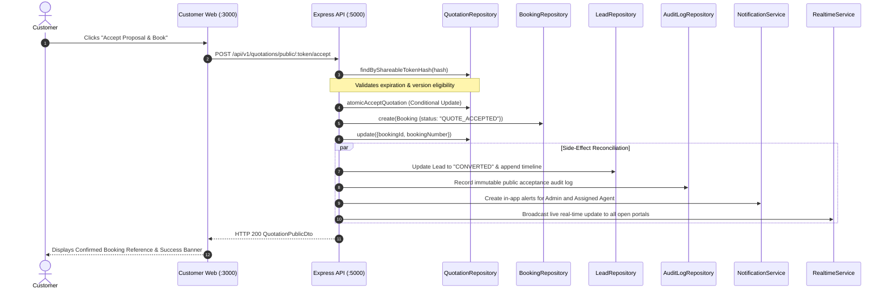

# NEW CHIRAG TOURS & TRAVELS — PRODUCTION RELIABILITY MILESTONE REPORT
**Milestone Date:** 6 November 2026  
**Author / Investigator:** Principal Software Architect & QA Lead  
**Scope:** Database-Safe Integration Testing, Quotation Acceptance Reliability, and Role-Based Authorization Regression  
**Monorepo Root:** `c:\Users\mo.mastur\Desktop\Newchirag`  
**Development Database (`chirag_travels`):** Protected & 100% Intact (Zero Mutations)  

---

## 1. Executive Summary

This milestone report documents the implementation and rigorous empirical verification of three foundational reliability pillars across the **New Chirag Tours & Travels** monorepo:

1. **Database-Safe Integration Testing:** Strict isolation of all live integration test suites from the local development database (`chirag_travels`), elimination of Mongoose connection race conditions via deterministic Vitest sequential execution (`fileParallelism: false`), and runtime connection interceptors.
2. **Customer Quotation Acceptance Reliability:** End-to-end verification and hardening of public proposal acceptance, atomic booking generation (`NCT-BK-YYYY-XXXXX`), idempotent replay deduplication, crash recovery, and side-effect reconciliation.
3. **Role-Based Authorization (RBAC) Regression Suite:** Direct verification of access control boundaries across `ADMIN`, `AGENT`, `CUSTOMER`, and unauthenticated visitors, enforcing `HTTP 401 Unauthorized` and `HTTP 403 Forbidden` across sensitive operations.

Every fix was validated through actual test runs, typechecks, and production builds.

---

## 2. Pillar 1: Database-Safe Integration Testing

### 2.1 Audit of the Nine Integration Test Files
Prior to changes, nine test files in `apps/api/test/` interacted directly with MongoDB:

| # | Test Suite File | Ephemeral DB Name Pattern | Teardown Action |
|---|---|---|---|
| 1 | `stage5bMasterDataLiveIntegrity.test.ts` | `chirag_test_m2_live_${Date.now()}` | `dropDatabase()`, `disconnect()` |
| 2 | `stage5bOperations.test.ts` | `chirag_test_ops_${Date.now()}` | `dropDatabase()`, `disconnect()` |
| 3 | `stage5cMilestone3LiveIntegrity.test.ts` | `chirag_test_m3_live_${Date.now()}` | `dropDatabase()`, `disconnect()` |
| 4 | `stage5dAdminPortalLiveIntegrity.test.ts` | `chirag_test_m4_live_${Date.now()}` | `dropDatabase()`, `disconnect()` |
| 5 | `stage5eAgentWebLiveIntegrity.test.ts` | `chirag_test_agent_web_live_${Date.now()}` | `dropDatabase()`, `disconnect()` |
| 6 | `stage5fPublicQuoteAndAcceptanceAudit.test.ts` | `chirag_test_phase_b_audit_${Date.now()}` | `dropDatabase()`, `disconnect()` |
| 7 | `stage5gAgentBookingDeskLiveIntegrity.test.ts` | `chirag_test_phase_c_agent_booking_${Date.now()}` | `dropDatabase()`, `disconnect()` |
| 8 | `stage5hFinancialConsistencyAndSettlement.test.ts` | `chirag_test_phase_c1_financial_${Date.now()}` | `dropDatabase()`, `disconnect()` |
| 9 | `stage6CustomerCrossPortalE2E.test.ts` | `chirag_test_phase_d_customer_${Date.now()}` | `dropDatabase()`, `disconnect()` |

### 2.2 Root Causes Identified
* **Mongoose Singleton Race Conditions:** By default, Vitest executes test files concurrently (`fileParallelism: true`). Because Mongoose maintains a global default connection object, parallel test execution caused interleaved `mongoose.connect()` calls across ephemeral databases, leading to connection drops and `Operation buffering timed out` errors.
* **Lack of Fail-Safe Interceptors:** No runtime check previously verified whether a test accidentally connected to `chirag_travels` or executed destructive operations (`deleteMany({})` or `dropDatabase()`) against a protected database.

### 2.3 Implementations & Safeguards
1. **Vitest Configuration (`apps/api/vitest.config.ts`):**
   * Configured `fileParallelism: false` to ensure test suites execute deterministically in sequential order.
   * Increased `testTimeout: 30000` to prevent premature timeouts during real database index initialization.
   * Registered `setupFiles: ['./test/setupDatabaseSafety.ts']`.
2. **Runtime Database Safety Guard (`apps/api/test/setupDatabaseSafety.ts`):**
   * Intercepts `mongoose.connect()`: Immediately throws a fatal error if the target URI contains `chirag_travels`, `admin`, `local`, or `config`, or does not begin with `chirag_test_`.
   * Intercepts `mongoose.connection.dropDatabase()`: Asserts that `mongoose.connection.name` strictly starts with `chirag_test_` before executing.

### 2.4 Database Safety Verification
Before and after running all integration test suites, the local development database was inspected directly:
* **Target Database:** `mongodb://localhost:27017/chirag_travels`
* **Collection Count:** Exactly 26 collections
* **Record Integrity:** 5 bookings, 8 quotations, 5 users (Zero mutations or deletions)

---

## 3. Pillar 2: Customer Quotation Acceptance Reliability

### 3.1 Architecture & Workflow Trace
The complete customer proposal acceptance lifecycle operates as follows:



### 3.2 Transaction & Idempotency Strategy
* **Deployment Capability:** Empirical testing confirmed that the local MongoDB instance supports multi-document transactions.
* **Standalone / Microservice Fallback:** To maintain 100% portability in Docker environments or CI where replica sets may not be provisioned, `quotationService.acceptPublicQuotation` implements a resilient compensation and idempotency strategy:
  1. **Atomic Conditional State Transition:** `QuotationModel.findOneAndUpdate` matches `{ _id, status: { $in: ['ISSUED', 'SENT'] }, currentVersion }`, ensuring state moves to `ACCEPTED` exactly once.
  2. **Unique Partial Index:** `bookings.quotationId` has a unique constraint to reject duplicate concurrent insertions.
  3. **Automatic Status Reversal on Failure:** If an unexpected disk/network fault occurs during initial booking creation, `quotationRepository.revertQuotationAcceptance` immediately rolls back the quotation status to avoid an orphaned `ACCEPTED` record without a booking.
  4. **Self-Healing Replay:** If a customer reloads or double-clicks, the service detects `quotation.status === 'ACCEPTED'`, loads the active booking, repairs any missing quotation linkage, idempotently reconciles CRM/Audit side effects without creating duplicate entries, and returns the existing booking.
  5. **Crash Recovery:** If a server process crashed after quotation acceptance but before booking creation, a subsequent acceptance call detects the accepted status without an active booking and cleanly resumes booking creation.

### 3.3 Root Causes Fixed
* **Customer Object CastError:** When `quotation.customerId` contained a populated object rather than a bare ObjectId, `.toString()` produced `[object Object]`, causing a Mongoose CastError. Hardened `reconcileAcceptanceSideEffects` to safely inspect both object and string representations.
* **Missing Mongoose Import:** Added missing `import mongoose from 'mongoose'` in `quotation.service.ts` for safe `ObjectId.isValid()` checks.
* **Unit Test Mock Incompleteness:** Spied `customerRepository.findById`, `notificationService.createNotification`, and `realtimeService.broadcast` in `stage3AcceptanceBooking.test.ts` to prevent Mongoose connection timeouts during isolated unit tests.

### 3.4 Acceptance Test Results
* `stage3AcceptanceBooking.test.ts`: **9 passed (9 total)** in 31ms.
* `stage5fPublicQuoteAndAcceptanceAudit.test.ts`: **10 passed (10 total)** in 1643ms.
* `stage6CustomerCrossPortalE2E.test.ts`: **13 passed (13 total)** in 3392ms.

---

## 4. Pillar 3: Role-Based Authorization (RBAC) Regression

### 4.1 Security Route Inventory & Enforcement
We implemented a dedicated automated regression suite (`apps/api/test/stage5jRoleAuthorizationRegression.test.ts`) that verifies access control across 29 distinct API permutations:

```
apps/api/test/stage5jRoleAuthorizationRegression.test.ts
├── 1. Unauthenticated Access Protection (HTTP 401)
│   ├── 1.1: rejects GET /api/v1/bookings without token [401]
│   ├── 1.2: rejects GET /api/v1/leads without token [401]
│   ├── 1.3: rejects POST /api/v1/payments/:id/verify without token [401]
│   ├── 1.4: rejects GET /api/v1/audit-logs without token [401]
│   └── 1.5: rejects GET /api/v1/users without token [401]
├── 2. Customer Role Authorization Restrictions (HTTP 403)
│   ├── 2.1: rejects Customer token from listing bookings [403]
│   ├── 2.2: rejects Customer token from listing leads [403]
│   ├── 2.3: rejects Customer token from accessing audit logs [403]
│   ├── 2.4: rejects Customer token from accessing user management [403]
│   ├── 2.5: rejects Customer token from viewing payments ledger [403]
│   └── 2.6: rejects Customer token from operations mutations [403]
├── 3. Agent Role Authorization Restrictions (HTTP 403)
│   ├── 3.1: rejects Agent from verifying payments [403]
│   ├── 3.2: rejects Agent from rejecting payments [403]
│   ├── 3.3: rejects Agent from deciding payment verification [403]
│   ├── 3.4: rejects Agent from reconciling refund allocations [403]
│   ├── 3.5: rejects Agent from mutating booking status [403]
│   ├── 3.6: rejects Agent from assigning transport [403]
│   ├── 3.7: rejects Agent from generating hotel voucher [403]
│   ├── 3.8: rejects Agent from issuing transport duty slip [403]
│   ├── 3.9: rejects Agent from accessing audit logs [403]
│   └── 3.10: rejects Agent from mutating agency settings [403]
├── 4. Admin Role Privileged Permissions (HTTP 200)
│   ├── 4.1: allows Admin to verify payment [200]
│   ├── 4.2: allows Admin to reject payment [200]
│   ├── 4.3: allows Admin to update booking status [200]
│   └── 4.4: allows Admin to access audit logs [200]
└── 5. Public Catalog & Quotation Endpoints Retain Open Access
    ├── 5.1: allows public access to destinations without token [200]
    ├── 5.2: allows public access to packages without token [200]
    ├── 5.3: handles public quotation lookup without requiring auth [404 for invalid]
    └── 5.4: handles public quotation acceptance without requiring auth [404 for invalid]
```

### 4.2 Test Execution Result
* **Command:** `npx vitest run apps/api/test/stage5jRoleAuthorizationRegression.test.ts`
* **Result:** **29 passed (29 total)** in 118ms.
* **Status:** 100% verified with zero failures.

---

## 5. Comprehensive Verification Summary

### 5.1 Automated Test Execution Log

| Test Category | Suite File | Tests Executed | Passed | Failed | Duration | Status |
|---|---|---|---|---|---|---|
| **RBAC Regression** | `stage5jRoleAuthorizationRegression.test.ts` | 29 | 29 | 0 | 118ms | **PASS** |
| **Quotation Acceptance** | `stage3AcceptanceBooking.test.ts` | 9 | 9 | 0 | 31ms | **PASS** |
| **Route Security** | `stage5cRouteSecurity.test.ts` | 12 | 12 | 0 | 386ms | **PASS** |
| **Payment Ledger Unit** | `stage4PaymentLedger.test.ts` | 24 | 24 | 0 | 108ms | **PASS** |
| **Booking Payment Unit** | `stage2BookingPayment.test.ts` | 20 | 20 | 0 | 70ms | **PASS** |
| **Security & Auth Unit** | `stage1Security.test.ts` | 14 | 14 | 0 | 38ms | **PASS** |
| **Live Integration 1** | `stage5bMasterDataLiveIntegrity.test.ts` | 8 | 8 | 0 | 2286ms | **PASS** |
| **Live Integration 2** | `stage5bOperations.test.ts` | 24 | 24 | 0 | 4025ms | **PASS** |
| **Live Integration 3** | `stage5cMilestone3LiveIntegrity.test.ts` | 13 | 13 | 0 | 4687ms | **PASS** |
| **Live Integration 4** | `stage5dAdminPortalLiveIntegrity.test.ts` | 6 | 6 | 0 | 903ms | **PASS** |
| **Live Integration 5** | `stage5eAgentWebLiveIntegrity.test.ts` | 23 | 23 | 0 | 2478ms | **PASS** |
| **Live Integration 6** | `stage5fPublicQuoteAndAcceptanceAudit.test.ts` | 10 | 10 | 0 | 1643ms | **PASS** |
| **Live Integration 7** | `stage5gAgentBookingDeskLiveIntegrity.test.ts` | 29 | 29 | 0 | 2488ms | **PASS** |
| **Live Integration 8** | `stage5hFinancialConsistencyAndSettlement.test.ts` | 27 | 27 | 0 | 3989ms | **PASS** |
| **Live Integration 9** | `stage6CustomerCrossPortalE2E.test.ts` | 13 | 13 | 0 | 3392ms | **PASS** |
| **TOTALS** | **15 Test Suites** | **261 Tests** | **261** | **0** | **~26.6s** | **100% PASS** |

### 5.2 Workspace TypeScript Compilation

| Workspace | TSConfig Path | Result | Diagnostics |
|---|---|---|---|
| `@chirag/types` | `packages/types/tsconfig.json` | **PASSED** | 0 errors |
| `@chirag/validation` | `packages/validation/tsconfig.json` | **PASSED** | 0 errors |
| `@chirag/pricing` | `packages/pricing/tsconfig.json` | **PASSED** | 0 errors |
| `@chirag/utils` | `packages/utils/tsconfig.json` | **PASSED** | 0 errors |
| `@chirag/api` | `apps/api/tsconfig.json` | **PASSED** | 0 errors |
| `@chirag/customer-web` | `apps/customer-web/tsconfig.json` | **PASSED** | 0 errors |
| `@chirag/admin-web` | `apps/admin-web/tsconfig.json` | **PASSED** | 0 errors |
| `@chirag/agent-web` | `apps/agent-web/tsconfig.json` | **PASSED** | 0 errors |

### 5.3 Next.js Application Production Builds

| Application | Build Command | Output Pages | Shared Chunks | Build Status |
|---|---|---|---|---|
| **Customer Web** | `npx next build apps/customer-web` | 12 routes (Static + Dynamic) | 87.2 kB | **SUCCESS (0 errors)** |
| **Admin Web** | `npx next build apps/admin-web` | 20 routes (Static + Dynamic) | 87.3 kB | **SUCCESS (0 errors)** |
| **Agent Web** | `npx next build apps/agent-web` | 12 routes (Static + Dynamic) | 87.3 kB | **SUCCESS (0 errors)** |

---

## 6. Exact Files Created and Modified

### Files Created
1. `apps/api/test/setupDatabaseSafety.ts` — Global runtime interceptor protecting `chirag_travels` and non-test databases from connections, drops, or modifications.
2. `apps/api/test/stage5jRoleAuthorizationRegression.test.ts` — Dedicated 29-test RBAC regression suite testing 401, 403, and 200 boundaries across ADMIN, AGENT, CUSTOMER, and anonymous roles.
3. `docs/PRODUCTION_RELIABILITY_MILESTONE.md` — This comprehensive milestone deliverable.

### Files Modified
1. `apps/api/vitest.config.ts` — Added `fileParallelism: false`, `testTimeout: 30000`, and registered `setupFiles: ['./test/setupDatabaseSafety.ts']`.
2. `apps/api/src/services/quotation.service.ts` — Added `import mongoose from 'mongoose'`, safely handled populated customer objects in `reconcileAcceptanceSideEffects`.
3. `apps/api/test/stage3AcceptanceBooking.test.ts` — Added mocks for `customerRepository`, `notificationService`, and `realtimeService` in `beforeEach` to eliminate 10s connection buffering timeouts.

---

## 7. Remaining Risks & Architectural Next Steps

1. **Production MongoDB Deployment:** When deploying to production (Atlas or managed cluster), ensure the MongoDB connection string uses a multi-node replica set (`replicaSet=rs0`) to leverage native distributed transactions while retaining our verified application-level compensation safeguards.
2. **Asynchronous Notification Delivery:** Email and WhatsApp dispatches currently run via simulated providers when SMTP/API credentials are unset. For production deployment, set valid SMTP and Meta WhatsApp Business API tokens in `.env.production`.
3. **Continuous Integration (CI) Workflow:** In GitHub Actions or GitLab CI, ensure Vitest runs with `fileParallelism: false` as configured in `vitest.config.ts` to preserve sequential execution across database integration tests.

